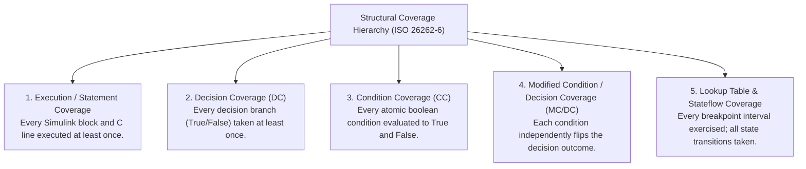
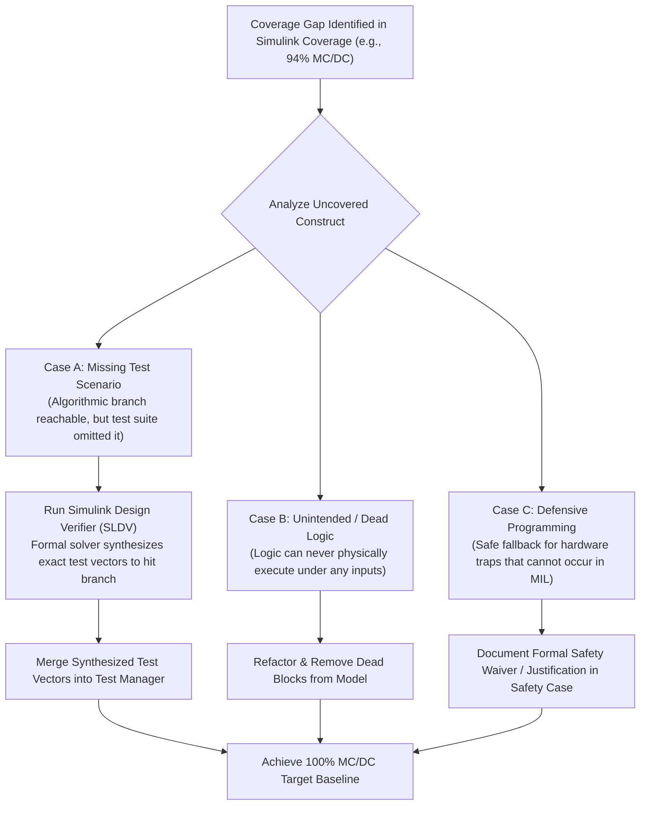

# Structural Code Coverage & MC/DC Analysis in Simulink

In the safety certification of automotive Battery Management Systems, showing that a test suite passes is only half the requirement. Under **ISO 26262 Part 6 Table 12**, engineering teams must mathematically prove that the test suite thoroughly exercises the internal structure of the software[^iso26262]. For **ASIL-D** applications, achieving **$100\%$ Modified Condition / Decision Coverage (MC/DC)** is strictly mandatory[^hayhurst2001].

**Simulink Coverage** measures structural test coverage directly on Simulink models, Stateflow state charts, and auto-generated C/C++ code. When coverage gaps occur, **Simulink Design Verifier (SLDV)** uses formal mathematical proof engines to synthesize missing test vectors or prove code deadness[^mathworks_cov2021].

This chapter formalizes the metrics of structural coverage, in-model visual diagnostics, and automated test vector generation with SLDV.

---

## The Hierarchy of Structural Coverage Metrics

ISO 26262-6 defines five distinct structural coverage metrics evaluated during Software-in-the-Loop (SIL) and Model-in-the-Loop (MIL) testing:



### Automotive Safety Integrity Level (ASIL) Recommendations

| Structural Coverage Metric | ASIL-A | ASIL-B | ASIL-C | ASIL-D |
| :--- | :--- | :--- | :--- | :--- |
| **Statement Coverage** | ++ (Highly Rec.) | ++ | ++ | ++ |
| **Branch / Decision Coverage** | + (Recommended) | ++ | ++ | ++ |
| **Modified Condition / Decision Coverage (MC/DC)** | o (Optional) | + | ++ | **++ (Mandatory)** |

---

## Visual Coverage Diagnostics in the Simulink Canvas

When test suites complete execution in Simulink Test, **Simulink Coverage** overlays interactive color-coded visual diagnostics directly on the model canvas[^mathworks_cov2021]:

```
+-------------------------------------------------------------------------------+
| Simulink Coverage Inspector: BMS_Safety_Logic.slx                             |
|                                                                               |
| [ GREEN BLOCK ]  Overvoltage_Comparator: 100% Decision (True: 512, False: 12) |
|                                                                               |
| [ YELLOW BLOCK ] Overtemp_AND_Overcurrent: 75% MC/DC                          |
|                  Expression: (T_cell > 60.0) && (I_pack > 100.0)              |
|                  > Condition 1 (T_cell > 60.0): Fully Covered                 |
|                  > Condition 2 (I_pack > 100.0): False->True Not Observed     |
|                                                                               |
| [ RED BLOCK ]    Unreachable_Fallback_SafeState: 0% Execution (Dead Logic!)   |
+-------------------------------------------------------------------------------+
```

- **Green:** $100\%$ covered across all active metrics (Statement, Decision, MC/DC).
- **Yellow:** Partially covered. The decision was evaluated in one direction, but the alternate branch or an atomic independence condition was never exercised by the test stimuli.
- **Red:** $0\%$ execution. Identifies dead logic or completely untested safety branches.

---

## Resolving Coverage Gaps: Formal Test Synthesis via SLDV

When structural coverage falls below $100\%$, ISO 26262 mandates that the gap must be resolved using a structured engineering workflow[^iso26262]:



### Automated Test Generation with Simulink Design Verifier (SLDV)

**Simulink Design Verifier (SLDV)** uses formal methods (Satisfiability Modulo Theories, SMT solvers, and model checking) to inspect the mathematical state-space of the model:
1. It analyzes the uncovered condition (e.g., Condition 2 in `(T_cell > 60.0) && (I_pack > 100.0)`).
2. It solves for the exact mathematical input vector sequence $[V(t), I(t), T(t)]$ required to force Condition 2 to independently flip the decision outcome.
3. If the solver proves that no mathematical input combination can ever execute the branch, it outputs an **Unsatisfiable / Dead Code Proof**, enabling engineers to safely remove the dead block.
4. If reachable, SLDV exports the synthesized test vectors directly as `.mat` files into the Simulink Test Manager, elevating coverage to **$100\%$ automatically**[^mathworks_cov2021].

---

## References

[^iso26262]: International Organization for Standardization. (2018). *ISO 26262-6: Road vehicles — Functional safety — Part 6: Product development at the software level*. ISO.
[^hayhurst2001]: Hayhurst, K. J., et al. (2001). *A Practical Tutorial on Modified Condition/Decision Coverage*. NASA/TM-2001-210876.
[^mathworks_cov2021]: The MathWorks Inc. (2021). *Simulink Coverage: Measure test completeness in models and generated code*. MathWorks.
