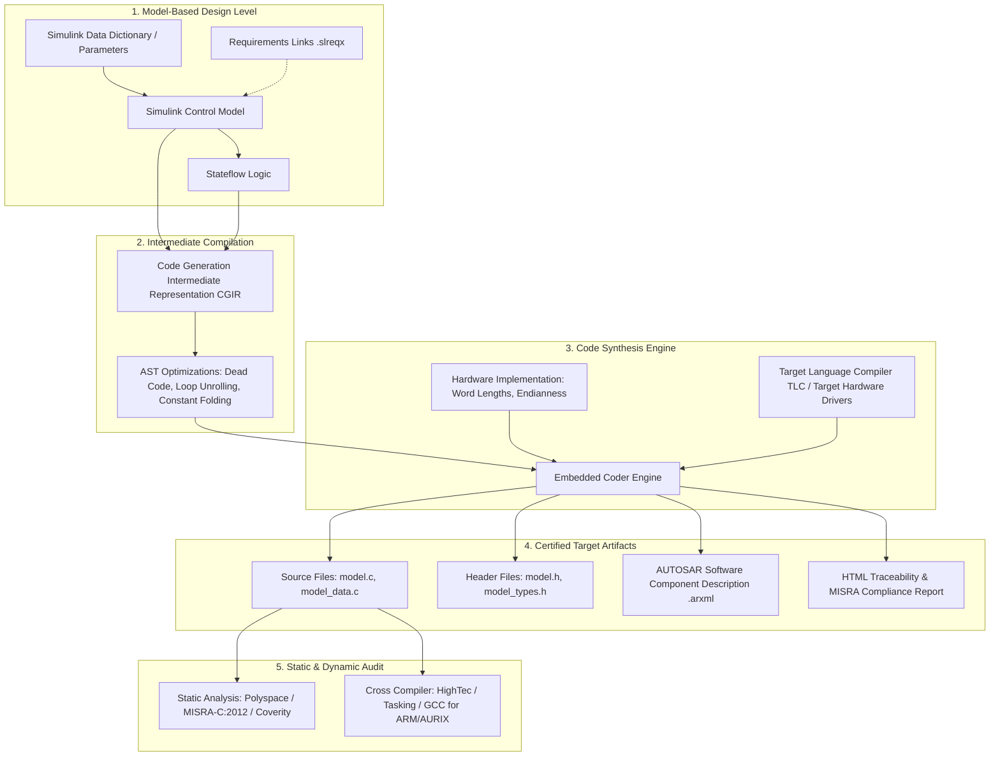
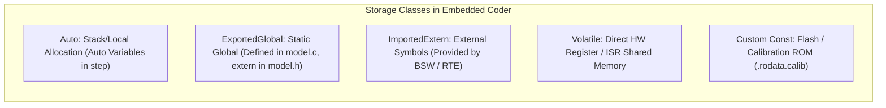
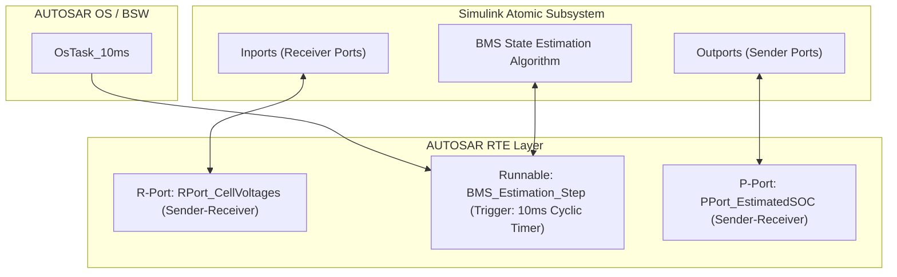
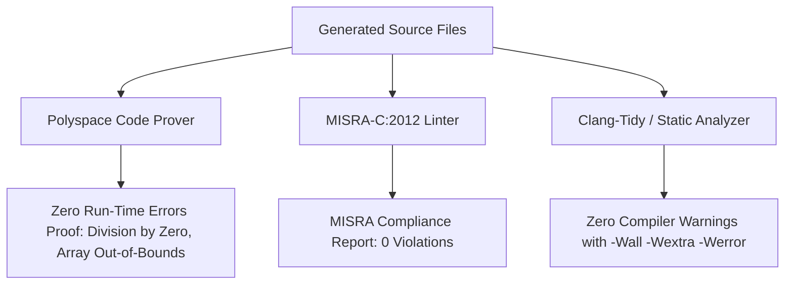

# Embedded Code Generation for Battery Management Systems

Model-Based Design (MBD) culminates in the automated translation of verified Simulink control models and Stateflow state machines into production-grade embedded C or C++ source code. In safety-critical automotive domains governed by **ISO 26262** (ASIL-D) and **ASPICE SWE.3** (Software Detailed Design and Unit Construction), manual coding is systematically superseded by certified automated code generation pipelines[^MathWorks2023]. Using tools such as MathWorks **Embedded Coder®**, battery management software can be synthesized with deterministic execution time, minimal memory footprints, strict static typing, and direct traceability back to architectural requirements[^Kramer2019].

This chapter provides an exhaustive technical analysis of embedded code generation for BMS controllers: from target configuration, memory section mapping, and MISRA-C:2012 compliance, to fixed-point scaling, function partitioning, and AUTOSAR Classic Classic Platform software component (SWC) generation.

---

## 1. Code Generation Architecture and Workflow

The automated code generation pipeline converts the graphical block diagram representation into an Intermediate Representation (IR), applies optimization algorithms, and synthesizes ANSI/ISO C code conforming to the target microcontroller's compiler characteristics.



### The Code Generation Pipeline
1. **Model Compilation & Type Propagation**: The Simulink engine determines execution order, resolves algebraic loops, and propagates data types, dimensions, and sample times ($T_s$) across all discrete blocks.
2. **CGIR Generation**: The model is flattened into an abstract syntax graph termed the *Code Generation Intermediate Representation* (CGIR)[^MathWorks2023].
3. **Graph Optimization Transforms**:
   - **Dead code elimination**: Removal of unreachable conditional branches or inactive blocks.
   - **Expression folding**: Combining multiple primitive operations into single compound statements to reduce temporary variables in RAM.
   - **Loop unrolling & function inlining**: Inlining atomic subsystems executed at high frequencies to eliminate call-overhead latency.
4. **Target Language Compilation (TLC)**: Embedded Coder utilizes TLC scripts to map CGIR nodes into target-specific C constructs, invoking hardware-accelerated instructions (e.g., DSP MAC units, intrinsic saturation operations).
5. **Artifact Generation**: Header files, source files, calibration parameter structures, and AUTOSAR XML (`.arxml`) interfaces are exported alongside an audit report[^Spitzer2015].

---

## 2. Target Hardware Configuration & Memory Architecture

Deploying BMS algorithms to automotive microcontrollers—such as the **Infineon AURIX™ TC397** (TriCore 32-bit architecture) or **TI Hercules™ TMS570** (ARM® Cortex®-R4F/R5F)—requires exact matching of hardware execution properties.

### 2.1 Hardware Implementation Configuration

In Simulink Configuration Parameters (`cs.set_param`), the hardware characteristics must be defined explicitly to prevent platform-dependent truncation or sign-extension defects:

| Parameter Setting | AURIX TC397 Target | ARM Cortex-R5F Target | Architectural Impact on BMS |
| :--- | :--- | :--- | :--- |
| `TargetHWDeviceType` | `Infineon->TriCore` | `ARM Compatible->ARM Cortex-R` | Controls compiler intrinsics and assembly emission. |
| `ProdBitPerChar` | 8 | 8 | Size of `uint8_T` and boolean flags. |
| `ProdBitPerShort` | 16 | 16 | Size of `uint16_T` (e.g., AFE ADC raw codes). |
| `ProdBitPerInt` | 32 | 32 | Size of loop counters and default integers. |
| `ProdBitPerLong` | 32 | 32 | Standard 32-bit integer data representation. |
| `ProdWordSize` | 32 | 32 | Native ALU register width; determines word alignment. |
| `ProdEndianess` | LittleEndian | LittleEndian | Network byte order conversion for CAN / SPI frames. |
| `ProdShiftRightIntArith`| `true` | `true` | Requires arithmetic shift (sign-preserving) for signed types. |

```matlab
% MATLAB Configuration Automation for Infineon TriCore ASIL-D Target
cs = getActiveConfigSet('BMS_Software_Unit');

% Configure Target Hardware Parameters
set_param(cs, 'TargetHWDeviceType', 'Infineon->TriCore');
set_param(cs, 'ProdEndianess', 'LittleEndian');
set_param(cs, 'ProdBitPerInt', 32);
set_param(cs, 'ProdWordSize', 32);

% Set Solvers to Discrete Fixed-Step (Mandatory for Embedded Execution)
set_param(cs, 'SolverType', 'Fixed-step');
set_param(cs, 'Solver', 'FixedStepDiscrete');
set_param(cs, 'FixedStep', '0.01'); % 10 ms base sample rate

% Enforce Strict Compliance
set_param(cs, 'GenCodeOnly', 'on');
set_param(cs, 'SystemTargetFile', 'ert.tlc'); % Embedded Real-Time Target
set_param(cs, 'TargetLang', 'C');
```

---

## 3. Data Dictionary, Storage Classes, and Memory Mapping

Safety standards mandate strict encapsulation of global data. Embedded Coder controls variable declaration, linkage, and memory location via **Storage Classes** defined in the **Simulink Data Dictionary (SLDD)** or the **Embedded Coder Mapping tool**[^Kramer2019].

### 3.1 Automotive Storage Class Taxonomies



- **`Auto`**: Variables allocated inside the model step function on the execution stack or folded into register operations. Bounded lifetime; zero RAM overhead between task periods.
- **`ExportedGlobal`**: System-level persistent variables defined in `BMS_Unit.c` and exposed via `BMS_Unit.h`. Used for inter-runnable data exchange within the same core.
- **`ImportedExtern`**: External sensors or diagnostic flags instantiated by the Basic Software (BSW) or operating system (OS). Embedded Coder generates an `extern` reference without allocating local storage.
- **`Volatile`**: Maps directly to hardware registers (e.g., AFE SPI DMA buffers) or inter-core shared memory. Tells the C compiler optimization engine (`-O2 / -O3`) never to cache the variable in an internal register or optimize out read operations.
- **`Const / Calibration`**: Maps to read-only non-volatile memory (Flash / `.rodata`), modifiable exclusively via XCP / CANape calibration protocols during runtime.

### 3.2 Defining Custom Storage Classes via MATLAB API

```matlab
% Instantiate Signal and Parameter Objects with Specific Memory Sections
Cell_Voltages = Simulink.Signal;
Cell_Voltages.DataType = 'single';
Cell_Voltages.Dimensions = [96 1];
Cell_Voltages.Complexity = 'real';
Cell_Voltages.StorageClass = 'ExportedGlobal';
Cell_Voltages.Description = 'Pack cell terminal voltages measured via AFE daisy-chain';

% Define Calibration Parameter in Flash ROM
OVP_Threshold = Simulink.Parameter;
OVP_Threshold.DataType = 'single';
OVP_Threshold.Value = 4.250; % Volts
OVP_Threshold.CoderInfo.StorageClass = 'Custom';
OVP_Threshold.CoderInfo.CustomStorageClass = 'Const';
OVP_Threshold.CoderInfo.CustomAttributes.HeaderFile = 'bms_calibrations.h';
OVP_Threshold.Description = 'Overvoltage Protection Threshold (ASIL-D)';
```

---

## 4. MISRA-C:2012 Compliance and Defensive Code Synthesis

Production BMS software must adhere to the **MISRA-C:2012** Guidelines for the use of the C language in critical systems[^MISRA2013]. Embedded Coder provides dedicated configuration presets that enforce MISRA compliance natively during code generation.

### 4.1 Critical MISRA-C:2012 Rules Enforced by Embedded Coder

1. **Rule 10.1 / 10.3 (Type Conversions & Implicit Casting)**:
   - *Requirement*: Operands shall not undergo implicit conversions that result in loss of precision or unexpected sign extension.
   - *Model Enforcement*: Cast blocks must be explicitly added; implicit mixed-mode arithmetic (e.g., `uint16_T` multiplied with `int32_T`) is blocked by enabling the diagnostic *Implicit type conversion -> Error*.
2. **Rule 12.2 (Shift Operations)**:
   - *Requirement*: The right-hand operand of a shift operator shall lie between zero and one less than the width in bits of the left-hand operand.
   - *Model Enforcement*: Bitwise shift blocks configured with bounding validation.
3. **Rule 14.3 (Controlling Expressions Invariant)**:
   - *Requirement*: Controlling expressions shall not be invariant (no tautological `while(1)` or `if(1)` except bounded task dispatchers).
   - *Model Enforcement*: Stateflow transitions are verified for complete conditional reachability.
4. **Rule 21.3 (Dynamic Memory Allocation Banned)**:
   - *Requirement*: `malloc()`, `calloc()`, `realloc()`, and `free()` shall never be used.
   - *Model Enforcement*: All state vectors, lookup tables, and arrays are statically pre-allocated at compile time. Variable-size arrays are strictly forbidden.

### 4.2 Embedded Coder Optimization Settings for ASIL-D

```matlab
% Set Embedded Coder Optimization Flags for Certified MISRA-C Compliance
set_param(cs, 'ZeroExternalMemoryAtStartup', 'on');
set_param(cs, 'ZeroInternalMemoryAtStartup', 'on');
set_param(cs, 'InitFltsAndDblsToZero', 'on');
set_param(cs, 'NoOverrunWarnings', 'off');

% Prevent Undefined Behaviors
set_param(cs, 'RemoveDisableFunc', 'on');
set_param(cs, 'RemoveResetFunc', 'on');
set_param(cs, 'SupportNonFinite', 'off'); % Disallows NaN and Inf (IEEE 754 non-compliant)
set_param(cs, 'SupportComplex', 'off');   % Disables complex math libraries
set_param(cs, 'SupportAbsoluteTime', 'off'); % Eliminates roll-over risks in 32-bit timers

% MISRA-C Diagnostic Checks
set_param(cs, 'ModelReferenceDataLoggingLevel', 'None');
set_param(cs, 'BooleanDataType', 'on');
set_param(cs, 'UnderSpecifiedDataTypeMsg', 'error');
set_param(cs, 'IntegerOverflowMsg', 'error');
```

---

## 5. Fixed-Point vs. Floating-Point Implementation

Automotive microcontrollers without a hardware Floating Point Unit (FPU), or power-constrained ASICs, necessitate **Fixed-Point Arithmetic**. Even with high-end FPUs (e.g., TriCore TC397 with single-precision FPU), certain safety paths utilize fixed-point representations to guarantee exact bit-for-bit repeatability across diverse toolchains[^Spitzer2015].

### 5.1 Fixed-Point Representation Fundamentals

A real-world continuous variable $x \in \mathbb{R}$ is approximated by an integer stored integer value $Q$ via linear slope-bias encoding:

$$
x \approx S \cdot Q + B
$$

where:
- $S = F \cdot 2^E$ is the scaling factor (comprising fractional slope $F \in [1.0, 2.0)$ and binary exponent $E \in \mathbb{Z}$),
- $B \in \mathbb{R}$ is the bias offset (typically $B = 0$ in DSP and control systems),
- $Q \in [-2^{N-1}, 2^{N-1}-1]$ for signed integers, or $Q \in [0, 2^N-1]$ for unsigned integers.

In pure binary radix scaling ($F=1, B=0$), this reduces to the standard fixed-point format $sfixN\_En$ (or standard notation $Q_{a.b}$ where $a$ is integer bits, $b$ is fractional bits):

$$
x = Q \cdot 2^{-b} \implies Q = \mathrm{round}\left( x \cdot 2^b \right)
$$

### 5.2 BMS Fixed-Point Quantization Example

Consider the calculation of cell terminal resistance $R_0 \in [0.0001\,\Omega, 0.0500\,\Omega]$ and pack current $I \in [-600.0\,\text{A}, +600.0\,\text{A}]$:

| Physical Quantity | Physical Range | Fixed-Point Type | Scaling ($S = 2^E$) | Resolution ($\Delta$) | Quantization Error ($\pm \Delta/2$) |
| :--- | :--- | :--- | :--- | :--- | :--- |
| Pack Current $I$ | $[-600, +600]\,\text{A}$ | `sfix16_En6` | $2^{-6} = 0.015625$ | $15.625\,\text{mA}$ | $\pm 7.81\,\text{mA}$ |
| Cell Voltage $V$ | $[0.0, 5.0]\,\text{V}$ | `ufix16_En13` | $2^{-13} \approx 0.000122$ | $122.07\,\mu\text{V}$ | $\pm 61.04\,\mu\text{V}$ |
| Internal Res. $R_0$ | $[0.0, 0.1]\,\Omega$ | `ufix16_En19` | $2^{-19} \approx 1.907\times 10^{-6}$ | $1.907\,\mu\Omega$ | $\pm 0.95\,\mu\Omega$ |
| Cell SOC | $[0.0, 1.0]$ | `ufix16_En16` | $2^{-16} \approx 1.526\times 10^{-5}$ | $0.001526\%$ | $\pm 0.00076\%$ |

When multiplying current and resistance to calculate the instantaneous ohmic overpotential $\eta_{\text{ohmic}} = I \cdot R_0$:

$$
Q_{\eta} = \left( Q_I \cdot Q_{R_0} \right) \cdot 2^{E_I + E_{R_0} - E_{\eta}}
$$

Embedded Coder synthesizes efficient integer shift and saturation instructions:

```c
/* Generated C Code: Fixed-point multiplication with saturation */
int32_T tmpCurrent = (int32_T)pack_current_Q6;
uint32_T tmpRes = (uint32_T)cell_r0_Q19;

/* Intermediate product in 64-bit accumulator to avoid overflow */
int64_T product = ((int64_T)tmpCurrent) * tmpRes; /* Exponent: -6 + (-19) = -25 */

/* Scale down to target format: ufix16_En13 (Exponent: -13). Right-shift: 25 - 13 = 12 */
int32_T scaled_eta = (int32_T)(product >> 12);

/* Apply strict saturation arithmetic */
if (scaled_eta > 65535) {
    v_ohmic_Q13 = 65535U;
} else if (scaled_eta < 0) {
    v_ohmic_Q13 = 0U;
} else {
    v_ohmic_Q13 = (uint16_T)scaled_eta;
}
```

---

## 6. Synthesis of Production-Grade BMS C Code

The following architecture demonstrates an end-to-end production module for an overvoltage protection monitor complying with ISO 26262 ASIL-D.

### 6.1 Generated Header File (`BMS_SafetyMonitor.h`)

```c
/**
 * @file    BMS_SafetyMonitor.h
 * @brief   Automated Code Generated by Embedded Coder (R2023b)
 * @target  Infineon TriCore AURIX TC397
 * @safety  ISO 26262-6 ASIL-D Compliant
 * @details Verification: MISRA-C:2012 strictly validated
 */

#ifndef RTW_HEADER_BMS_SafetyMonitor_h_
#define RTW_HEADER_BMS_SafetyMonitor_h_

#include "rtwtypes.h"

/* Exported Global Signals */
extern real32_T BMS_CellVoltages[96];       /* Input: Cell voltages from AFE (V) */
extern real32_T BMS_PackCurrent;           /* Input: Shunt transducer current (A) */
extern boolean_T BMS_OVP_FaultLatched;      /* Output: Hardware trip safety flag */

/* Calibration Parameters (Mapped to Non-Volatile Flash .rodata) */
typedef struct {
    real32_T V_Cell_Max_Threshold;          /* 4.250 V */
    real32_T V_Cell_Recovery_Threshold;     /* 4.150 V */
    uint16_T OVP_Debounce_Time_ms;          /* 100 ms */
} BMS_Calibration_Data_t;

extern const BMS_Calibration_Data_t BMS_Calib_Const;

/* Model Step and Initialization Signatures */
extern void BMS_SafetyMonitor_Init(void);
extern void BMS_SafetyMonitor_Step(void);   /* Periodic task period: 10 ms */

#endif /* RTW_HEADER_BMS_SafetyMonitor_h_ */
```

### 6.2 Generated Implementation File (`BMS_SafetyMonitor.c`)

```c
/**
 * @file    BMS_SafetyMonitor.c
 * @brief   Overvoltage Protection Runnable Implementation
 */

#include "BMS_SafetyMonitor.h"

/* Internal Static Persistent States */
static uint16_T ovp_debounce_counter = 0U;

/* Calibration Structure in Flash */
const BMS_Calibration_Data_t BMS_Calib_Const = {
    .V_Cell_Max_Threshold = 4.250F,
    .V_Cell_Recovery_Threshold = 4.150F,
    .OVP_Debounce_Time_ms = 100U
};

/* Exported Variables */
real32_T BMS_CellVoltages[96];
real32_T BMS_PackCurrent;
boolean_T BMS_OVP_FaultLatched;

/**
 * @brief  Initialization Routine
 * @req    REQ_BMS_SFT_001: Safe system start-up state
 */
void BMS_SafetyMonitor_Init(void)
{
    ovp_debounce_counter = 0U;
    BMS_OVP_FaultLatched = false;
}

/**
 * @brief  Cyclic Task Step Function (Executed at 100 Hz / 10 ms)
 * @req    REQ_BMS_SFT_002: ISO 26262 ASIL-D Overvoltage Shutdown within 100 ms
 */
void BMS_SafetyMonitor_Step(void)
{
    uint8_T idx;
    boolean_T overvoltage_detected = false;
    const uint16_T debounce_limit = BMS_Calib_Const.OVP_Debounce_Time_ms / 10U;

    /* Scan all 96 series cells */
    for (idx = 0U; idx < 96U; idx++) {
        if (BMS_CellVoltages[idx] >= BMS_Calib_Const.V_Cell_Max_Threshold) {
            overvoltage_detected = true;
            break; /* Early exit upon first violation */
        }
    }

    /* Debounce Logic */
    if (overvoltage_detected) {
        if (ovp_debounce_counter < debounce_limit) {
            ovp_debounce_counter++;
        }
        if (ovp_debounce_counter >= debounce_limit) {
            BMS_OVP_FaultLatched = true; /* Permanent fault trip */
        }
    } else {
        if (ovp_debounce_counter > 0U) {
            ovp_debounce_counter--;
        }
    }
}
```

---

## 7. AUTOSAR Classic SWC Generation

In standard automotive Electronic Control Units (ECUs), the generated code is packaged into an **AUTOSAR Classic Software Component (SWC)**. Embedded Coder utilizes the **AUTOSAR Blockset** to synthesize the complete AUTOSAR interface[^AUTOSAR2020].



### 7.1 AUTOSAR Configuration Workflow
1. **Set System Target File**: Change `SystemTargetFile` to `autosar.tlc`.
2. **Define Schema Version**: Target AUTOSAR Release 4.3 or 4.4 (`ARXML` export standard).
3. **Configure RTE Communication**:
   - **Sender-Receiver (S-R)**: Asynchronous data transfer for continuous signals (e.g., cell voltages, pack temperature, SOC).
   - **Client-Server (C-S)**: Synchronous function calls for non-volatile memory read/write (`NvM_ReadBlock`, `NvM_WriteBlock`) and diagnostic error management (`Dem_SetEventStatus`).
4. **Runnable Mapping**: Map the model step function to an AUTOSAR Runnable Entity (`Runnable_BMS_Step`) triggered by a periodic timing event (`TimingEvent_10ms`).
5. **Code Emission**: Embedded Coder produces both the C code containing `Rte_Read_*` and `Rte_Write_*` macro calls, and the companion XML metadata (`BMS_SWC.arxml`) for integration into Vector DaVinci Configurator or Elektrobit Tresos.

---

## 8. Static Analysis and Verification Metrics

Prior to compiler compilation, the generated C files must undergo rigorous static code analysis.



### Static Analysis Criteria Table

| Verification Domain | Tool Used | Target Requirement | Pass/Fail Metric |
| :--- | :--- | :--- | :--- |
| **Run-Time Errors** | Polyspace Code Prover™ | ISO 26262-6 Table 1 | Zero orange/red defects (100% green: no overflow, no pointer corruption, no division-by-zero). |
| **Coding Standards** | PC-Lint Plus / Axivion | MISRA-C:2012 | Zero unapproved rule deviations. Deviations must have formal safety justification. |
| **Cyclomatic Complexity** | Embedded Coder Report | $v(G) \le 10$ per function | Ensures low branching complexity and high maintainability. |
| **Stack Usage** | AbsInt StackAnalyzer | Worst-Case Stack Depth | Max stack consumption $\le 80\%$ of allocated OS task stack allocation. |
| **Memory Footprint** | Linker Map File | ROM/RAM Budgets | Algorithm execution fits within bounded TC397 DSPR (Data Scratchpad RAM). |

---

## 9. References

[^MathWorks2023]: MathWorks, "Embedded Coder® User's Guide (Release 2023b)," *The MathWorks Inc.*, Natick, MA, 2023.
[^Kramer2019]: B. Kramer, R. Simons, and S. Huh, "Model-Based Design of Battery Management Systems for Electric Vehicles," *SAE Technical Paper 2019-01-0872*, 2019. [DOI: 10.4271/2019-01-0872](https://doi.org/10.4271/2019-01-0872)
[^Spitzer2015]: C. R. Spitzer, U. Ferrell, and T. Ferrell, *Digital Avionics and Automotive Embedded Systems: Architecture and Verification*, CRC Press, 2015.
[^MISRA2013]: Motor Industry Software Reliability Association, *MISRA C:2012 - Guidelines for the Use of the C Language in Critical Systems*, MIRA Ltd., Nuneaton, UK, 2013.
[^AUTOSAR2020]: AUTOSAR Consortium, "Specification of Software Component Template (Release 4.4.0)," *AUTOSAR Standard Documents*, Nov. 2020.
