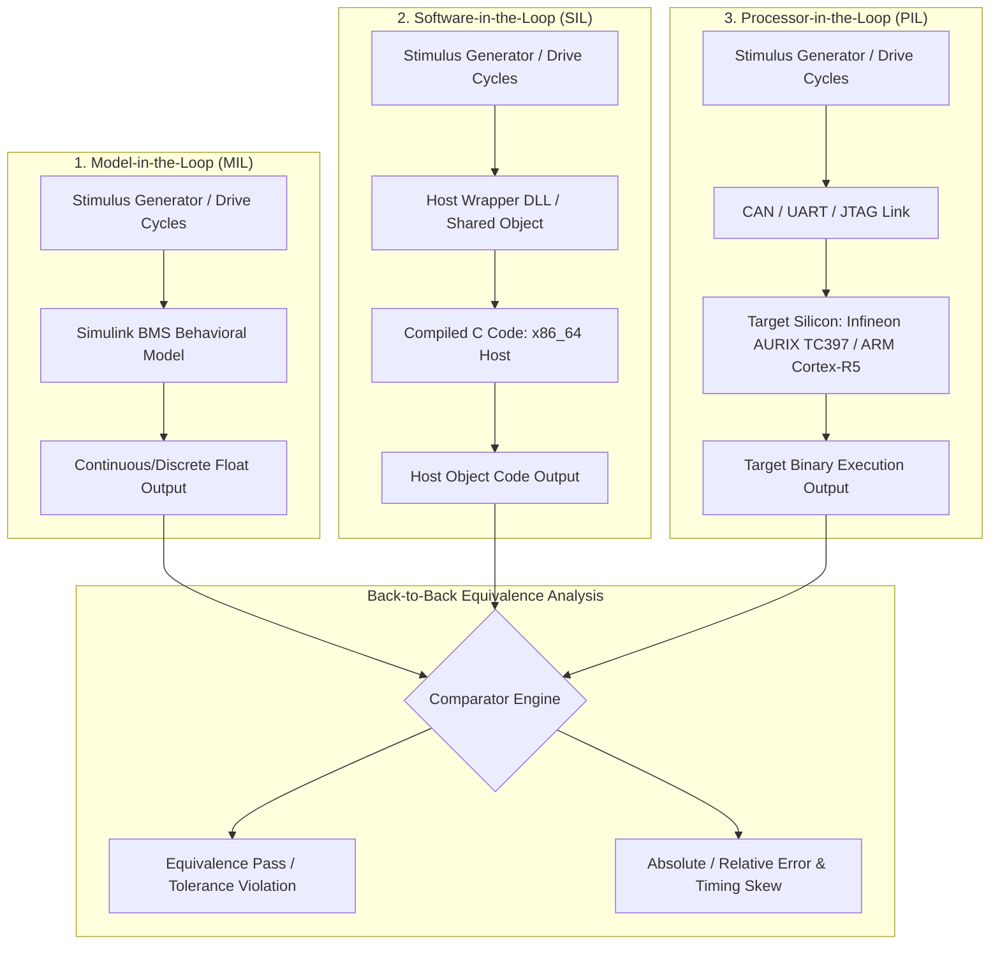
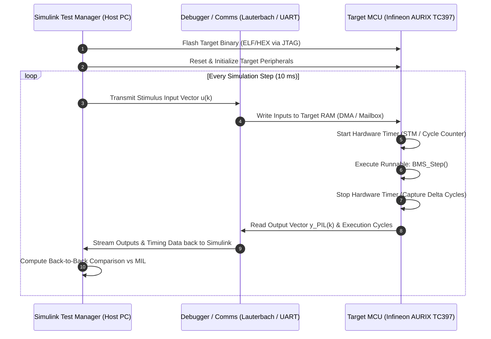
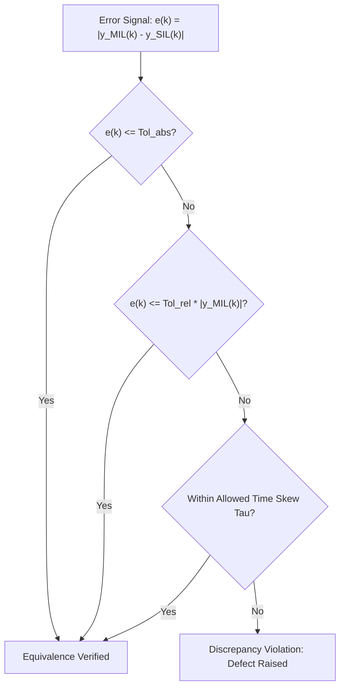
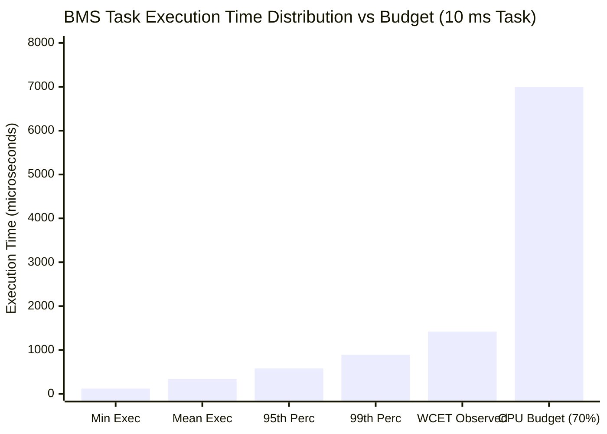

# Verification of Generated Code: SIL and PIL Testing

In Model-Based Design (MBD), verifying that compiled object code behaves identically to the high-level graphical model is an indispensable milestone. Governed by **ISO 26262-6** (Clauses 9 and 10) and **ASPICE SWE.4** (Software Unit Verification), automated code verification mandates **Back-to-Back Testing** to prove that the translation from design models to target binary code does not inject unintended functionality, numerical corruption, or timing anomalies[^ISO26262_6].

This chapter details the theoretical and practical frameworks for **Software-in-the-Loop (SIL)** and **Processor-in-the-Loop (PIL)** testing of Battery Management System (BMS) software, exploring numerical equivalence metrics, cross-compilation toolchains, execution profiling, and worst-case execution time (WCET) measurement[^MathWorksSIL2023].

---

## 1. The Verification Hierarchy: MIL vs. SIL vs. PIL

Code verification bridges the gap between simulated continuous/discrete physics and compiled assembly executing on physical silicon.



### 1.1 Systematic Comparison of Execution Levels

| Metric / Dimension | Model-in-the-Loop (MIL) | Software-in-the-Loop (SIL) | Processor-in-the-Loop (PIL) |
| :--- | :--- | :--- | :--- |
| **Execution Engine** | Simulink Simulation Engine (Host) | Native Host Binary (`.dll`, `.so`) | Target Microcontroller (Core/Eval Board) |
| **Compilation Toolchain** | Not Applicable (Interpreted / Model Reference) | Host C/C++ Compiler (MSVC, GCC, Clang) | Target Cross-Compiler (Tasking, HighTec, TI ARM) |
| **Target Architecture** | Host CPU (x86_64 / ARM64) | Host CPU (x86_64 / ARM64) | Production Microcontroller (e.g., TriCore 32-bit) |
| **Primary Objective** | Functional & Algorithmic Validation | Code Generation Correctness & MISRA-C | Compiler Semantics, Target Endianness, WCET |
| **Execution Speed** | Moderate to Fast | Fastest (Native compiled machine code) | Slower (Throttled by JTAG/UART communication) |
| **Execution Timing** | Virtual Simulation Time ($t_{\text{sim}}$) | Virtual Simulation Time ($t_{\text{sim}}$) | Execution Cycle Counts ($t_{\text{target}}$) logged |
| **Memory Emulation** | Floating-point Double / Single | Host Memory Model (64-bit Pointers) | Target Memory Map (32-bit Pointers, Flash/RAM) |

---

## 2. Software-in-the-Loop (SIL) Verification

SIL execution verifies the generated C/C++ source code directly on the development host. The code generator wraps the synthesized source files (`.c`, `.h`) into a compiled C-MEX S-function or dynamic library.

### 2.1 The Host Compilation Loop

During SIL simulation:
1. Simulink feeds input vectors $u(k)$ at discrete time-step $k$ into the SIL wrapper.
2. The wrapper passes pointers to the generated `model_step()` function.
3. The host compiled C code computes the state updates $x(k+1)$ and outputs $y_{\text{SIL}}(k)$.
4. The outputs are returned to the Simulink engine for visualization, logging, and automated assertion checking[^Broy2012].

### 2.2 Numerical Discrepancies and Root Causes

Although SIL executes the identical algorithmic equations, subtle divergences between MIL and SIL can emerge:
- **Intermediate Accumulator Precision**: Host x86_64 FPUs may utilize 80-bit Extended Precision registers (x87) or 128/256-bit SSE/AVX registers, whereas the Simulink model simulates standard IEEE 754 32-bit single-precision arithmetic[^Goldberg1991].
- **Compiler Optimizations**: Aggressive compiler flags (e.g., `-O3`, `-ffast-math`) may reorder floating-point operations:

$$
(a + b) + c \neq a + (b + c)
$$

Because floating-point addition is non-associative, reordered operations in matrix inversions (such as the Extended Kalman Filter innovation covariance $S_k = H_k P_k^- H_k^T + R_k$) introduce roundoff drift.
- **Integer Saturation and Wrap-Around**: Implicit type conversions that behave predictably in Simulink blocks may cause compiler-dependent undefined behavior if sign extension rules are violated.

---

## 3. Processor-in-the-Loop (PIL) Testing & Hardware Co-Simulation

PIL testing executes the production binary on the actual embedded target (or a certified target instruction set simulator). This step is essential to validate platform-dependent attributes that cannot be audited on a PC[^Kramer2019].



### 3.1 Target Specific Hazards Uncovered Exclusively by PIL
1. **Endianness Differences**: If the host is Little-Endian and the target communicates with Big-Endian peripheral registers without proper byte swapping (`htons`, `htonl`), bitfields and CAN frame unpacking will corrupt state vectors.
2. **Memory Alignment & Structure Padding**: 32-bit TriCore or ARM Cortex-R architectures enforce word alignment (4-byte boundaries). Unaligned memory accesses in multi-cell telemetry structures can trigger hardware traps (`BusFault` / `DataAbort`).
3. **Hardware FPU Behavior**: Verification of target hardware division-by-zero traps, subnormal float handling, and denormalized number flush-to-zero (FTZ) modes.
4. **Compiler Optimization Bugs**: Verification that the target cross-compiler (e.g., Tasking VX-toolset for TriCore with `-O2`) does not generate flawed machine instructions for safety-critical logic.

---

## 4. Formal Equivalence Metrics and Tolerance Formulations

In back-to-back testing, identical signals from MIL, SIL, and PIL are subtracted point-by-point. A test passes if the residual error lies strictly within predefined tolerance boundaries across the entire mission profile[^ISO26262_6].

### 4.1 Mathematical Tolerance Formulation

For an output vector $y(t)$ sampled at discrete instants $t_k = k \cdot T_s$:

$$
e(k) = \left| y_{\text{MIL}}(k) - y_{\text{SIL/PIL}}(k) \right|
$$

The verification criteria mandate that:

$$
e(k) \le \text{Tol}_{\text{abs}} + \text{Tol}_{\text{rel}} \cdot \left| y_{\text{MIL}}(k) \right|
$$

where:
- $\text{Tol}_{\text{abs}}$ is the **Absolute Tolerance**, defined by physical sensor resolution (e.g., $1\,\text{mV}$ for cell voltage, $10\,\text{mA}$ for current).
- $\text{Tol}_{\text{rel}}$ is the **Relative Tolerance**, capturing floating-point scale effects (typically $10^{-4}$ to $10^{-6}$).



### 4.2 Handling Delay and Time Skew ($\tau_{\text{skew}}$)

When code generation inserts pipeline registers, or when multi-tasking schedulers introduce execution delays, the output signal may experience a 1-step sample delay:

$$
y_{\text{PIL}}(k) = y_{\text{MIL}}(k - 1)
$$

The comparison algorithm must account for allowable time shifts $\tau \in [-T_s, +T_s]$ before flagging a false-positive violation:

$$
e_{\text{skew}}(k) = \min_{\tau \in [-\tau_{\text{max}}, \tau_{\text{max}}]} \left| y_{\text{MIL}}(t_k + \tau) - y_{\text{PIL}}(t_k) \right|
$$

---

## 5. Execution Profiling and WCET Analysis

PIL testing provides deterministic empirical data regarding task execution duration on the target silicon.

### 5.1 Real-Time Execution Budget Equation

To avoid task overruns in a cyclic automotive operating system (AUTOSAR OS), the **Worst-Case Execution Time (WCET)** of the BMS runnable must satisfy the budget margin:

$$
\text{WCET} \le \rho_{\text{max}} \cdot T_{\text{task}} - \tau_{\text{OS\_overhead}}
$$

where:
- $T_{\text{task}}$ is the cyclic task period (e.g., $10\,\text{ms}$ for cell supervisory control, $1\,\text{ms}$ for current/voltage limiters),
- $\rho_{\text{max}} \in (0, 1]$ is the maximum permissible CPU utilization limit (typically $0.70$ or $70\%$ to preserve headroom for interrupts),
- $\tau_{\text{OS\_overhead}}$ represents the context switch latency and interrupt service routine (ISR) preemption overhead.

### 5.2 Microcontroller Instruction Cycle Profiling

Target execution duration is captured directly via the microcontroller's hardware cycle counter:

$$
T_{\text{exec}} = \frac{\Delta N_{\text{cycles}}}{f_{\text{CPU}}}
$$

For an Infineon AURIX TC397 running at $f_{\text{CPU}} = 300\,\text{MHz}$:
- $1\,\text{cycle} = \frac{1}{300\times 10^6} \approx 3.33\,\text{ns}$
- A step function taking $45,000\,\text{cycles}$ equates to $T_{\text{exec}} = 45,000 \times 3.33\,\text{ns} = 150\,\mu\text{s}$.



---

## 6. Target Code Coverage Verification (ISO 26262-6 Table 12)

While Model Coverage (MCDC) is audited on the graphical blocks, ISO 26262 ASIL-D requires proof that the compiler has not introduced untraceable code or branches.

### 6.1 Structural Coverage Criteria on Object Code
1. **Statement Coverage**: Every machine instruction in the compiled binary has been executed at least once.
2. **Branch / Decision Coverage**: Every conditional branch instruction (e.g., `JNE`, `BNE`) has been taken in both true and false directions.
3. **MCDC on Assembly Level**: Proves that compiler optimizations (such as conditional moves or predicated instructions) do not obfuscate safety-critical condition independence[^Chilenski2001].

---

## 7. Automated SIL/PIL Test Automation Script

The following MATLAB script automates the end-to-end execution of a BMS Overvoltage Protection test suite across MIL, SIL, and PIL environments, computing back-to-back equivalence metrics and generating an audit report.

```matlab
%% Automated SIL/PIL Back-to-Back Verification Pipeline
% Project: ASIL-D Battery Management System
% Standard: ISO 26262-6 Clauses 9, 10

clc; clear; close all;
modelName = 'BMS_SafetyMonitor';
testFile = 'BMS_Verification_Suite.mldatx';

fprintf('[INFO] Opening Model: %s\n', modelName);
load_system(modelName);

% Step 1: Open Test Manager and Load Suite
sltest.testmanager.clear();
tf = sltest.testmanager.load(testFile);
testSuite = getTestSuiteByName(tf, 'Overvoltage_Tests');
testCase = getTestCaseByName(testSuite, 'OVP_Dynamic_Pulse_Test');

% Step 2: Configure Test for Back-to-Back Equivalence
fprintf('[INFO] Configuring Back-to-Back Test: Simulation 1 = MIL, Simulation 2 = SIL\n');
setProperty(testCase, 'SimulationMode', 'Equivalence');

% Simulation 1: Normal (MIL)
sim1 = getSimulationSetting(testCase, 1);
setProperty(sim1, 'Model', modelName);
setProperty(sim1, 'SimulationMode', 'Normal');

% Simulation 2: Software-in-the-Loop (SIL)
sim2 = getSimulationSetting(testCase, 2);
setProperty(sim2, 'Model', modelName);
setProperty(sim2, 'SimulationMode', 'Software-in-the-Loop (SIL)');

% Step 3: Define Equivalence Tolerances
fprintf('[INFO] Setting Equivalence Tolerances\n');
tolSignal = addTolerance(testCase, 'BMS_CellVoltages');
tolSignal.AbsoluteTolerance = 0.001; % 1 mV
tolSignal.RelativeTolerance = 0.0001; % 0.01%

tolFault = addTolerance(testCase, 'BMS_OVP_FaultLatched');
tolFault.AbsoluteTolerance = 0.0; % Exact boolean match required

% Step 4: Run Back-to-Back Execution
fprintf('[INFO] Executing Equivalence Run...\n');
resultSet = sltest.testmanager.run();

% Step 5: Extract and Evaluate Results
result = getTestResult(resultSet);
status = getProperty(result, 'Outcome');
fprintf('[RESULT] Overall Equivalence Status: %s\n', char(status));

if strcmp(char(status), 'Passed')
    fprintf('[PASS] SIL code is mathematically equivalent to MIL model!\n');
else
    fprintf('[FAIL] Discrepancies detected exceeding safety threshold.\n');
end

% Step 6: Export ISO 26262 Verification Evidence Report
reportPath = fullfile(pwd, 'SIL_Equivalence_Audit_Report.pdf');
sltest.testmanager.report(resultSet, reportPath, ...
    'IncludeMLDVR', true, ...
    'IncludeCoverageResult', true);
fprintf('[INFO] Verification report generated: %s\n', reportPath);
```

---

## 8. References

[^ISO26262_6]: International Organization for Standardization, "Road vehicles — Functional safety — Part 6: Product development at the software level," *ISO Standard 26262-6:2018*, Dec. 2018.
[^MathWorksSIL2023]: MathWorks, "Simulink® Verification and Validation: Software-in-the-Loop and Processor-in-the-Loop Testing," *The MathWorks Inc.*, Natick, MA, 2023.
[^Broy2012]: M. Broy, M. Feilkas, M. Herrmannsdoerfer, S. Merenda, and D. Ratiu, "Seamless model-based software engineering: Systems engineering meets software engineering," *IEEE Transactions on Software Engineering*, vol. 38, no. 5, pp. 1113–1129, 2012.
[^Goldberg1991]: D. Goldberg, "What every computer scientist should know about floating-point arithmetic," *ACM Computing Surveys (CSUR)*, vol. 23, no. 1, pp. 5–48, 1991.
[^Kramer2019]: B. Kramer, R. Simons, and S. Huh, "Model-Based Design of Battery Management Systems for Electric Vehicles," *SAE Technical Paper 2019-01-0872*, 2019. [DOI: 10.4271/2019-01-0872](https://doi.org/10.4271/2019-01-0872)
[^Chilenski2001]: J. J. Chilenski, "An investigation of modified condition/decision coverage (MC/DC) for airborne software," *Federal Aviation Administration Technical Report DOT/FAA/AR-01/18*, 2001.
