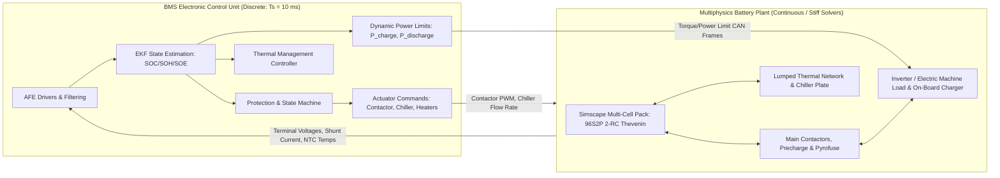
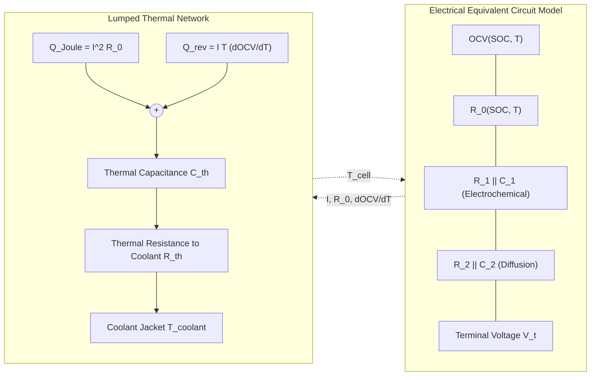
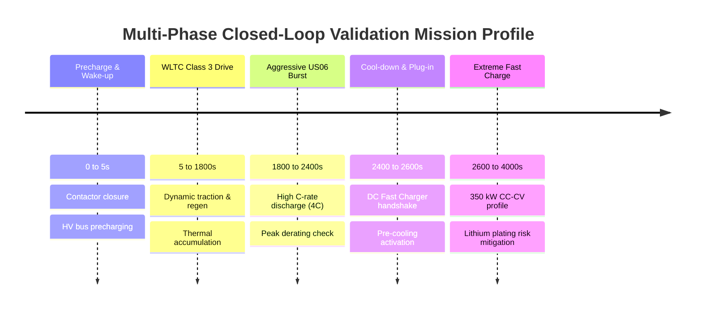
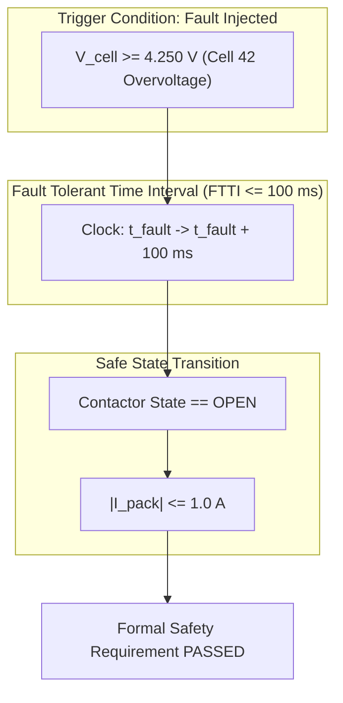
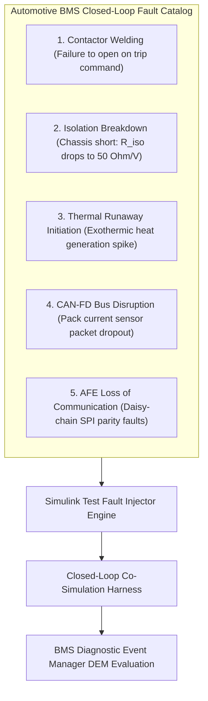

# Closed-Loop System Validation and Co-Simulation

Closed-loop testing is the apex of Model-Based Design (MBD) prior to hardware integration. While open-loop unit testing validates isolated algorithms against canned stimuli, **Closed-Loop System Testing** couples the Battery Management System (BMS) control algorithms directly to high-fidelity, multiphysics physical plant models[^Kramer2019]. This reciprocal interaction validates dynamic feedback stability, state-estimation convergence, thermal regulation, safety interlocks, and fault mitigation across real-world automotive drive cycles and extreme charging profiles[^Plett2015].

This chapter provides an exhaustive technical breakdown of closed-loop BMS validation: multi-physics plant coupling, co-simulation numerical dynamics, drive cycle synthesis, formal temporal logic assertions, and system-level fault injection under **ISO 26262** and **ASPICE SWE.5 / SWE.6**[^ISO26262_4].

---

## 1. Closed-Loop System Architecture

In a closed-loop co-simulation, the plant and controller form a bidirectional dynamic feedback loop operating across mixed continuous-discrete domains.



### 1.1 The Reciprocal Feedback Dynamic
1. **Actuation & Load Demand**: The vehicle or charging station requests power $P_{\text{req}}(t)$ based on driver pedal inputs (WLTP drive cycles) or fast-charging profiles.
2. **Current Draw & Overpotentials**: The pack current $I_{\text{pack}}(t)$ flows through all series cells, generating instantaneous ohmic drops and slow diffusion overpotentials across the RC networks.
3. **Heat Generation**: Joule heating and entropic reversible heat generate thermal energy $\dot{Q}_{\text{gen}}$, driving cell temperature elevation.
4. **Telemetry Feedback**: Simulated analog front-ends (AFE) digitize voltages, currents, and temperatures, superimposing measurement noise, quantization errors, and line impedance.
5. **Controller Derating**: If cell temperatures or voltages approach safe operating limits (SOA), the BMS controller dynamically curtails maximum permissible charge/discharge current ($I_{\text{max\_chg}}, I_{\text{max\_dis}}$), forcing the powertrain to reduce power consumption[^Plett2015].

---

## 2. Multi-Physics Battery Plant Modeling

To deliver high-fidelity closed-loop fidelity, the plant model incorporates electro-thermal dynamics, auxiliary high-voltage components, and vehicle road load physics.

### 2.1 Multi-Cell Electro-Thermal Plant Dynamics

Each series-connected cell is modeled via an expanded **2-RC Dual Polarization Thevenin Equivalent Circuit** coupled to a lumped-parameter thermal node:



The mathematical state equations for cell $i \in \{1, \dots, N_{\text{cells}}\}$ are governed by:

$$
\frac{d v_{1,i}}{dt} = -\frac{1}{R_{1,i} C_{1,i}} v_{1,i} + \frac{1}{C_{1,i}} I(t)
$$

$$
\frac{d v_{2,i}}{dt} = -\frac{1}{R_{2,i} C_{2,i}} v_{2,i} + \frac{1}{C_{2,i}} I(t)
$$

$$
V_{t,i}(t) = \text{OCV}_i(\text{SOC}_i, T_i) - v_{1,i}(t) - v_{2,i}(t) - I(t) \cdot R_{0,i}(\text{SOC}_i, T_i)
$$

The thermal dissipation balance across cell thermal mass $C_{\text{th}}$ is:

$$
C_{\text{th}} \frac{d T_i}{dt} = I(t)^2 R_{0,i} + I(t)^2 R_{1,i} + I(t)^2 R_{2,i} + I(t) T_i \frac{\partial \text{OCV}_i}{\partial T} - \frac{T_i - T_{\text{coolant}}}{R_{\text{th\_pack}}}
$$

where:
- $\frac{\partial \text{OCV}}{\partial T}$ is the entropic temperature coefficient ($\text{V/K}$),
- $R_{\text{th\_pack}}$ represents conductive heat transfer through thermal gap filler to the liquid-cooled aluminum cold plate.

---

## 3. Co-Simulation Numerical Dynamics and Solver Setup

Coupling stiff, nonlinear differential algebraic equations (DAEs) of physical power circuits with discrete multi-rate digital controllers poses significant numerical challenges.

### 3.1 Solver Selection and Step-Size Tuning

Standard explicit solvers (e.g., `ode45`, `ode23`) fail or experience extreme step-size collapse when simulating switching power electronics and electrochemical stiffness.

| Solver | Formulation | Ideal Use Case in BMS Closed Loop | Stability & Performance Profile |
| :--- | :--- | :--- | :--- |
| `ode23t` | Trapezoidal rule with free interpolation | Simscape electro-thermal packs and contactors | **Recommended**: Preserves energy conservation, moderate numerical damping. |
| `ode15s` | Variable-order Backward Differentiation (BDF) | Highly stiff chemical kinetics or severe transients | Robust against extreme stiffness, but computationally heavier. |
| `FixedStepDiscrete`| Euler / Heun fixed step ($T_s$) | Real-time SIL / PIL / HIL code generation | Requires step size $T_s \le \frac{1}{10} \min(\tau_{RC})$ to prevent instability. |

```matlab
% Recommended Closed-Loop Solver Settings in Simulink
set_param(modelName, 'SolverType', 'Variable-step');
set_param(modelName, 'Solver', 'ode23t');
set_param(modelName, 'MaxStep', '0.001');      % 1 ms maximum integration step
set_param(modelName, 'MinStep', '1e-7');       % 100 ns minimum step for switching
set_param(modelName, 'RelTol', '1e-4');        % 0.01% relative tolerance
set_param(modelName, 'AbsTol', '1e-6');
set_param(modelName, 'MaxConsecutiveMinSteps', '100');
```

---

## 4. Driving and Charging Mission Profiles

Closed-loop testing must subject the virtual battery pack to standardized operational conditions covering urban congestion, high-speed highway sprints, and high-power fast charging[^Baronti2014].



### 4.1 Standardized Drive Cycles
- **Worldwide Harmonised Light Vehicles Test Procedure (WLTP Class 3)**:
  - Validates SOC estimation accuracy over $1,800\,\text{s}$ duration, peak speeds of $131.3\,\text{km/h}$, and varied regenerative braking energies.
- **US06 Supplemental Federal Test Procedure (SFTP)**:
  - High-acceleration aggressive highway profile; peak discharge rates up to $4\text{C}$ to $5\text{C}$ testing instantaneous dynamic overpotential models and voltage-sag derating.
- **Extreme Fast Charging (XFC - 350 kW DC Fast Charging)**:
  - Multi-stage Constant Current Constant Voltage (CC-CV) protocol. Validates active chiller pump throttling and high-temperature cutoff algorithms ($T_{\text{pack}} \ge 55^\circ\text{C}$).

---

## 5. Formal Safety Verification via Temporal Logic Assertions

Simulink Test enables mathematical verification of system safety requirements using **Temporal Logic Assessments**. These assertions verify not only steady-state conditions, but exact time-domain envelopes mandated by ISO 26262[^ISO26262_4].



### 5.1 Temporal Logic Assessment Formulations

1. **Overvoltage Protection FTTI Response**:
   - *Requirement*: Whenever any cell voltage exceeds $4.25\,\text{V}$ for longer than $50\,\text{ms}$, the main contactors must transition to `OPEN` within $100\,\text{ms}$, and pack current must decay below $1.0\,\text{A}$.
   - *Formal Temporal Logic Specification*:

$$
\square \left( \left( \exists i : V_i \ge 4.25\,\text{V} \right) \text{ held for } 50\,\text{ms} \implies \lozenge_{\le 100\,\text{ms}} \left( \text{State}_{\text{contactor}} == \text{OPEN} \land |I_{\text{pack}}| \le 1.0\,\text{A} \right) \right)
$$

2. **Precharge Sequence Timeout Assertion**:
   - *Requirement*: Upon key-on, precharge must complete within $500\,\text{ms}$ ($V_{\text{link}} \ge 0.95 \cdot V_{\text{pack}}$); otherwise, the precharge contactor must abort opening within $20\,\text{ms}$.
   - *Formal Specification*:

$$
\square \left( \text{PrechargeStarted} \land \neg \lozenge_{\le 500\,\text{ms}} \left( V_{\text{link}} \ge 0.95 V_{\text{pack}} \right) \implies \lozenge_{\le 20\,\text{ms}} \left( \text{PrechargeContactor} == \text{OPEN} \land \text{FaultLatched} \right) \right)
$$

3. **Active Thermal Derating Assertion**:
   - *Requirement*: If maximum cell temperature exceeds $50^\circ\text{C}$, discharge power limit $P_{\text{dis\_max}}$ must scale down monotonically:

$$
\square \left( T_{\text{max}} \ge 50^\circ\text{C} \implies P_{\text{dis\_max}} \le P_{\text{nominal}} \cdot \left(1 - \frac{T_{\text{max}} - 50^\circ\text{C}}{10^\circ\text{C}}\right) \right)
$$

---

## 6. Closed-Loop Fault Injection Experiments

A robust closed-loop harness provides native mechanisms to inject electrical, mechanical, and thermal anomalies dynamically during simulation execution.



### 6.1 Fault Injection Matrix

| Fault ID | Injected Phenomenon | Injection Point | Expected BMS Closed-Loop Action | ISO 26262 ASIL |
| :--- | :--- | :--- | :--- | :--- |
| **FLT_CL_01** | Negative contactor welded closed | Simscape Relay Block switch state | Detect weld via differential voltage sensor; trip positive contactor; inhibit restart | ASIL-D |
| **FLT_CL_02** | Shunt current sensor bias ($+15\,\text{A}$) | Current measurement feedback line | EKF innovation residual exceeds threshold $\gamma_k$; trigger sensor plausibility fault | ASIL-C |
| **FLT_CL_03** | Isolation breakdown ($R_{\text{iso}} = 50\,\Omega/\text{V}$)| DC+ bus to chassis virtual resistor | Bender insulation monitor flags isolation warning ($< 500\,\Omega/\text{V}$) within $5\,\text{s}$ | ASIL-B |
| **FLT_CL_04** | Cell internal micro-short ($R_{\text{leak}} = 10\,\Omega$)| Cell #12 parallel leakage path | High self-discharge detected by resting cell balancing manager; set warning | ASIL-C |
| **FLT_CL_05** | Coolant flow loss ($0\,\text{L/min}$)| Thermal boundary condition flow | Thermal controller derates current; triggers Emergency Stop before $T_{\text{cell}} \ge 60^\circ\text{C}$| ASIL-D |

---

## 7. Automated Closed-Loop Test Runner Script

The following script executes a closed-loop WLTP mission profile, monitors formal temporal assertions, evaluates thermal derating performance, and logs critical validation metrics.

```matlab
%% Automated Closed-Loop BMS Co-Simulation Runner
% System: Full 400V Pack + Simscape Multiphysics Plant + Discrete BMS ECU

clc; clear; close all;
harnessModel = 'BMS_ClosedLoop_Harness';

fprintf('[INFO] Initializing Closed-Loop Model: %s\n', harnessModel);
load_system(harnessModel);

% Step 1: Configure Co-Simulation Parameters
set_param(harnessModel, 'StopTime', '1800'); % Full WLTC Class 3 Drive Cycle
set_param(harnessModel, 'Solver', 'ode23t');
set_param(harnessModel, 'MaxStep', '0.005'); % 5 ms step limit

% Step 2: Inject Dynamic Environmental Profiles
fprintf('[INFO] Loading WLTP Drive Cycle and Ambient Profile (T_amb = 35 degC)\n');
evalin('base', 'T_ambient = 35.0;'); % Elevated ambient temperature
evalin('base', 'Chiller_Coolant_Temp = 20.0;');

% Step 3: Execute Co-Simulation
fprintf('[INFO] Simulating Closed-Loop Dynamics...\n');
tic;
simOut = sim(harnessModel);
simDuration = toc;
fprintf('[INFO] Simulation completed in %.2f seconds.\n', simDuration);

% Step 4: Extract Logged Simulation Vectors
logsout = simOut.get('logsout');
time = logsout.get('Pack_Current').Values.Time;
current = logsout.get('Pack_Current').Values.Data;
maxCellTemp = logsout.get('Max_Cell_Temperature').Values.Data;
minCellVolt = logsout.get('Min_Cell_Voltage').Values.Data;
estSOC = logsout.get('Estimated_SOC').Values.Data;
trueSOC = logsout.get('True_Pack_SOC').Values.Data;

% Step 5: Evaluate Verification Acceptance Criteria
socRMSE = sqrt(mean((trueSOC - estSOC).^2));
fprintf('[RESULT] SOC Estimation RMSE: %.4f%%\n', socRMSE * 100);

maxObservedTemp = max(maxCellTemp);
fprintf('[RESULT] Peak Cell Temperature Reached: %.2f degC\n', maxObservedTemp);

% Step 6: Verify Assertions
assert(socRMSE < 0.015, 'CRITICAL: SOC estimation error exceeds 1.5% limit!');
assert(maxObservedTemp < 55.0, 'CRITICAL: Cell temperature exceeded maximum safety threshold of 55 degC!');
assert(min(minCellVolt) >= 2.80, 'CRITICAL: Under-voltage limit (2.80V) violated during drive cycle!');

fprintf('[SUCCESS] All closed-loop system requirements successfully verified.\n');
```

---

## 8. References

[^Kramer2019]: B. Kramer, R. Simons, and S. Huh, "Model-Based Design of Battery Management Systems for Electric Vehicles," *SAE Technical Paper 2019-01-0872*, 2019. [DOI: 10.4271/2019-01-0872](https://doi.org/10.4271/2019-01-0872)
[^Plett2015]: G. L. Plett, *Battery Management Systems, Volume I: Battery Modeling*, Artech House, 2015.
[^ISO26262_4]: International Organization for Standardization, "Road vehicles — Functional safety — Part 4: Product development at the system level," *ISO Standard 26262-4:2018*, Dec. 2018.
[^Baronti2014]: F. Baronti, R. Roncella, and R. Saletti, "Performance comparison of active balancing techniques for lithium-ion batteries," *Journal of Power Sources*, vol. 267, pp. 603–609, 2014.
