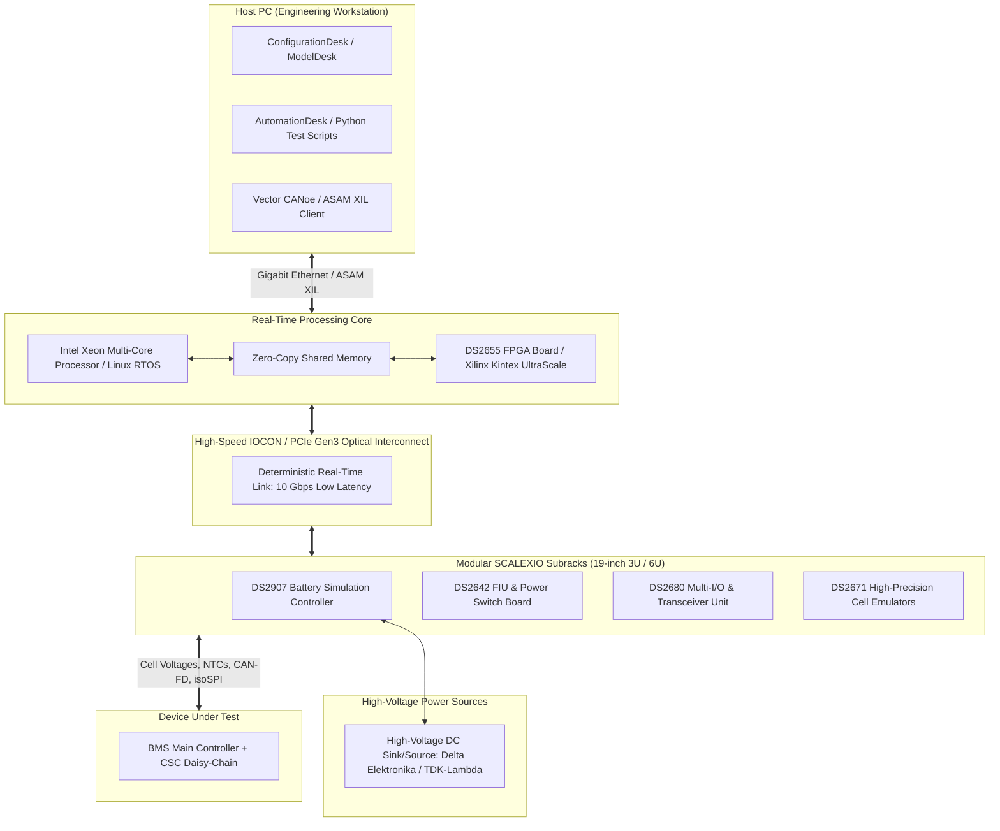
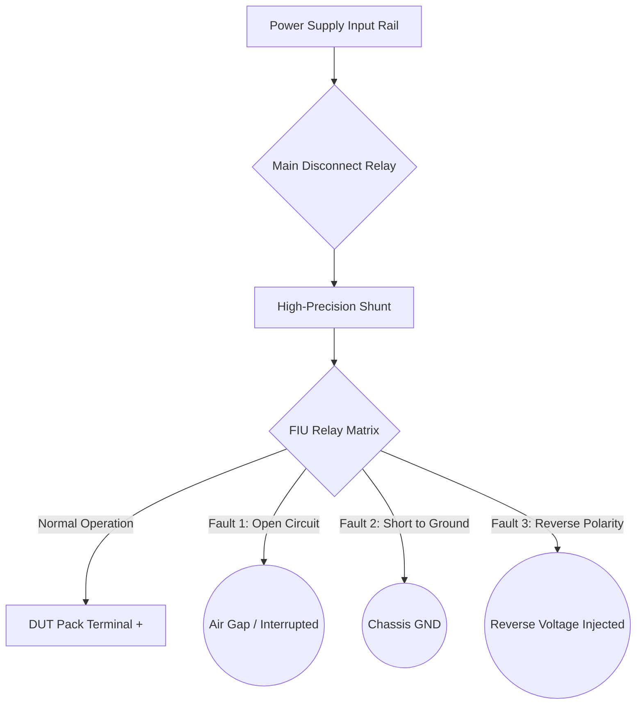
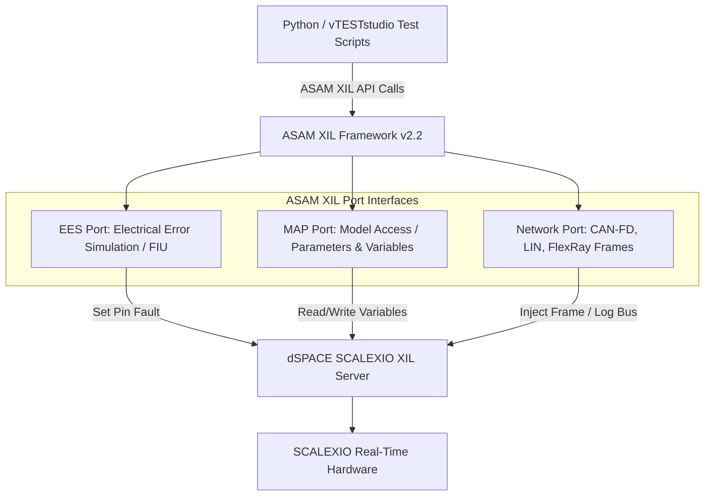

# dSPACE SCALEXIO Real-Time Architecture for BMS HIL

Hardware-in-the-Loop (HIL) simulation represents the gold standard for validating electronic control units (ECUs) under realistic, real-time closed-loop conditions without endangering expensive physical battery packs or personnel. In the automotive industry, the **dSPACE SCALEXIO®** modular real-time platform is the preeminent system for battery management system testing, capable of handling extreme voltage levels (up to $1,500\,\text{V}$ DC), sub-millivolt cell voltage emulation, and nanosecond-level fault injection[^dSPACE2023].

This chapter explores the architectural foundations of dSPACE SCALEXIO for BMS applications: the multiprocessor real-time processing core, high-speed input/output (I/O) subsystems, battery simulation controllers, external power supply coupling, and ASAM XIL automation standards[^Ploeger2018].

---

## 1. SCALEXIO System Architecture Overview

The SCALEXIO hardware topology decouples real-time computation from physical signal conditioning via a high-bandwidth, deterministic I/O network known as the **IOCON (I/O Controller Network)**[^dSPACE2023].



### 1.1 Structural Components
1. **Real-Time Processing Unit**: High-performance Intel® Xeon® multi-core processors running a customized Real-Time Linux kernel. Processing cores are isolated: dedicated cores execute the electro-thermal plant model at fixed rates (e.g., $100\,\mu\text{s}$), while separate cores manage I/O communication and network protocols.
2. **IOCON Optical Interconnect**: A proprietary, low-latency, serial LVDS/PCIe interconnect that streams sensor, actuator, and fault states between the processing unit and distributed I/O boards at rates up to $10\,\text{Gbps}$ with deterministic jitter under $50\,\text{ns}$.
3. **FPGA Coprocessing Board (DS2655)**: Houses Xilinx® UltraScale™ FPGAs to execute sub-microsecond computations, such as high-frequency PWM capture, hardware resolver emulation, and nanosecond-precision Fault Injection Unit (FIU) control[^Ploeger2018].

---

## 2. The DS2907 Battery Simulation Controller

The **DS2907 Battery Simulation Controller** serves as the central control intelligence for multi-channel cell emulation and high-voltage power integration.

```mermaid
flowchart LR
    subgraph DS2907_Architecture["DS2907 Controller Architecture"]
        CTRL_CORE[Microcontroller & FPGA Logic]
        SLOT_A[Simulation Module Slot 1: Master]
        SLOT_B[Simulation Module Slot 2: Slave]
        COMM_IF[Isolated High-Speed Bus: 100 Mbps]
        CTRL_CORE --- SLOT_A
        CTRL_CORE --- SLOT_B
        CTRL_CORE --- COMM_IF
    end

    subgraph Power_Stage["Power Supply Interface"]
        PWR_1[TDK-Lambda Genesys+ 60V / 25A]
        PWR_2[Delta SM15/100 15V / 100A]
    end

    subgraph Cell_Stack["Emulated Battery Stack"]
        STACK_A[Cells 1 to 48 (Module 1)]
        STACK_B[Cells 49 to 96 (Module 2)]
    end

    SLOT_A <-->|Analog/Digital Control| PWR_1
    SLOT_B <-->|Analog/Digital Control| PWR_2
    PWR_1 --> STACK_A
    PWR_2 --> STACK_B
```

### 2.1 Technical Specifications of the DS2907 Module
- **Slot Capacity**: Accommodates two independent battery simulation modules per board, enabling concurrent control of two separate power rails.
- **Power Supply Interfacing**: Supports leading commercial bidirectional power supplies (Delta Elektronika SM-series, TDK-Lambda Genesys+ series) via galvanically isolated CAN, Ethernet, or low-noise analog interfaces ($\pm 10\,\text{V}$).
- **Dynamic Voltage Tracing**: Real-time closed-loop voltage adjustment with update frequencies exceeding $10\,\text{kHz}$, ensuring that sudden load current transients applied by the BMS (such as contactor precharge or active balancing) produce instantaneous, physically realistic voltage sags[^dSPACE2023].

---

## 3. Power Supply Switching and Hardware Fault Injection

In battery HIL testing, testing nominal operation is secondary to verifying catastrophic safety interlocks. The **DS2642 FIU & Power Switch Board** acts as an inline hardware protection and fault insertion mechanism.

### 3.1 Relay Matrix Architecture and Fault Modes



### 3.2 Electrical Protection Specifications
- **Galvanic Isolation**: Rated up to $1,500\,\text{V}$ continuous dielectric breakdown isolation between the low-voltage control plane (IOCON/PCIe) and the high-voltage pack terminals.
- **Switching Speed**: Fast electromagnetic and solid-state relays achieve disconnection within $\le 5\,\text{ms}$, protecting sensitive DUT circuitry in the event of an unmodelled short-circuit condition.
- **Interlock Loop Integration**: The board includes dual-channel hardware interlock inputs wired to the test bench safety cage and emergency stop buttons. Opening the cage de-energizes all power supplies in under $2\,\text{ms}$ via hardware tripping without relying on software intervention[^ISO26262_5].

---

## 4. Real-Time Signal Conditioning and I/O Modules

A complete BMS HIL rack integrates a broad spectrum of digital, analog, and communication channels:

| Module Identifier | Hardware Role | Technical Specifications | Target BMS Interface |
| :--- | :--- | :--- | :--- |
| **DS2671** | High-Precision Cell Voltage Emulator | 6 channels per board, $\pm 1\,\text{mV}$ accuracy, $\pm 5\,\text{A}$ sink/source | Battery Cell Monitoring Wire Harness |
| **DS2680** | Multi-I/O and Protocol Transceiver | 16x ADC, 16x DAC, 32x DIO, 4x CAN-FD, 2x FlexRay | Contactors, Pyrofuse, HVIL, Current Sensor |
| **DS2655** | FPGA Coprocessor & isoSPI Board | Kintex UltraScale, nanosecond cycle time, proprietary transceivers | Linear Tech / ADI isoSPI, TI BQ daisy-chain |
| **DS2621** | Programmable Resistor Module | 0 to $10\,\text{M}\Omega$, $0.1\,\Omega$ resolution, 24 channels | NTC / PTC Pack Temperature Sensors |
| **DS2642** | Fault Insertion Unit (FIU) | 16-channel high-current relay matrix, 30 A continuous | Line breaks, pin shorts, reverse voltage |

---

## 5. ASAM XIL Test Automation Architecture

To maintain cross-platform test script portability across diverse toolchains (e.g., dSPACE SCALEXIO, Vector VT System, NI PXI), modern test benches adhere to the **ASAM XIL** (Association for Standardisation of Automation and Measuring Systems) API standard[^ASAM2020].



### 5.1 Python ASAM XIL Test Script Example
The following script utilizes the ASAM XIL Python binding to automate an overvoltage cutoff verification on SCALEXIO:

```python
"""
Automated Overvoltage Protection Verification on dSPACE SCALEXIO
Standard: ASAM XIL v2.2.0 API & ISO 26262 ASIL-D
"""

import time
from asam.xil import Framework, Environment

# Initialize ASAM XIL Framework
framework = Framework.create()
env = framework.get_environment("dSPACE_SCALEXIO_Rack1")

# Connect to Model Access Port (MAP) and Electrical Error Simulation (EES) Port
map_port = env.get_map_port("ModelAccessPort")
ees_port = env.get_ees_port("FaultInjectionPort")

print("[INFO] Connected to SCALEXIO Real-Time Platform via ASAM XIL.")

try:
    # Step 1: Initialize Battery Pack Emulation (96 Cells at 3.700 V)
    print("[STEP 1] Setting nominal pack voltage (355.2 V, 3.700 V/cell)...")
    for cell_idx in range(1, 97):
        map_port.write_variable(f"Model Root/Battery_Pack/Cell_{cell_idx}/Voltage", 3.700)
    
    # Allow BMS to close contactors and enter STANDBY
    time.sleep(2.0)
    contactor_state = map_port.read_variable("DUT/BMS_MainContactor_Feedback")
    assert contactor_state == 1, "Failed: BMS did not close contactors in nominal state!"
    print("[PASS] BMS in Active Closed-Loop State.")

    # Step 2: Inject Overvoltage Fault on Cell #23 (Ramp to 4.300 V)
    print("[STEP 2] Injecting Overvoltage condition on Cell 23 (4.300 V)...")
    map_port.write_variable("Model Root/Battery_Pack/Cell_23/Voltage", 4.300)
    t_fault_start = time.time()

    # Step 3: Monitor Fault Tolerant Time Interval (FTTI <= 100 ms)
    trip_detected = False
    while (time.time() - t_fault_start) < 0.200: # 200 ms timeout window
        contactor_state = map_port.read_variable("DUT/BMS_MainContactor_Feedback")
        if contactor_state == 0:
            trip_time_ms = (time.time() - t_fault_start) * 1000.0
            trip_detected = True
            break
        time.sleep(0.005) # 5 ms poll interval

    assert trip_detected, "CRITICAL HAZARD: BMS failed to open contactor upon overvoltage!"
    assert trip_time_ms <= 100.0, f"VIOLATION: FTTI exceeded! Trip time: {trip_time_ms:.2f} ms"
    print(f"[PASS] Overvoltage detected and contactors opened in {trip_time_ms:.2f} ms (FTTI <= 100 ms).")

finally:
    # Reset Environment to Safe Standby
    print("[CLEANUP] Resetting all voltages and restoring fault matrix...")
    map_port.write_variable("Model Root/Battery_Pack/Cell_23/Voltage", 3.700)
    ees_port.clear_all_faults()
    framework.dispose()
```

---

## 6. References

[^dSPACE2023]: dSPACE GmbH, "SCALEXIO® Hardware and Architecture Manual," *dSPACE Technical Documentation*, Paderborn, Germany, 2023.
[^Ploeger2018]: M. Ploeger and H. V. Richter, "Hardware-in-the-Loop Simulation for Modern High-Voltage Automotive Systems," *ATZelektronik worldwide*, vol. 13, no. 4, pp. 38–43, 2018. [DOI: 10.1007/s38314-018-0036-7](https://doi.org/10.1007/s38314-018-0036-7)
[^ISO26262_5]: International Organization for Standardization, "Road vehicles — Functional safety — Part 5: Product development at the hardware level," *ISO Standard 26262-5:2018*, Dec. 2018.
[^ASAM2020]: Association for Standardisation of Automation and Measuring Systems, "ASAM XIL Standard: Generic Test Automation API, Version 2.2.0," *ASAM e.V.*, Nov. 2020.
