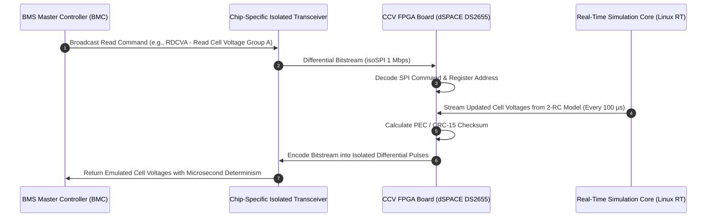
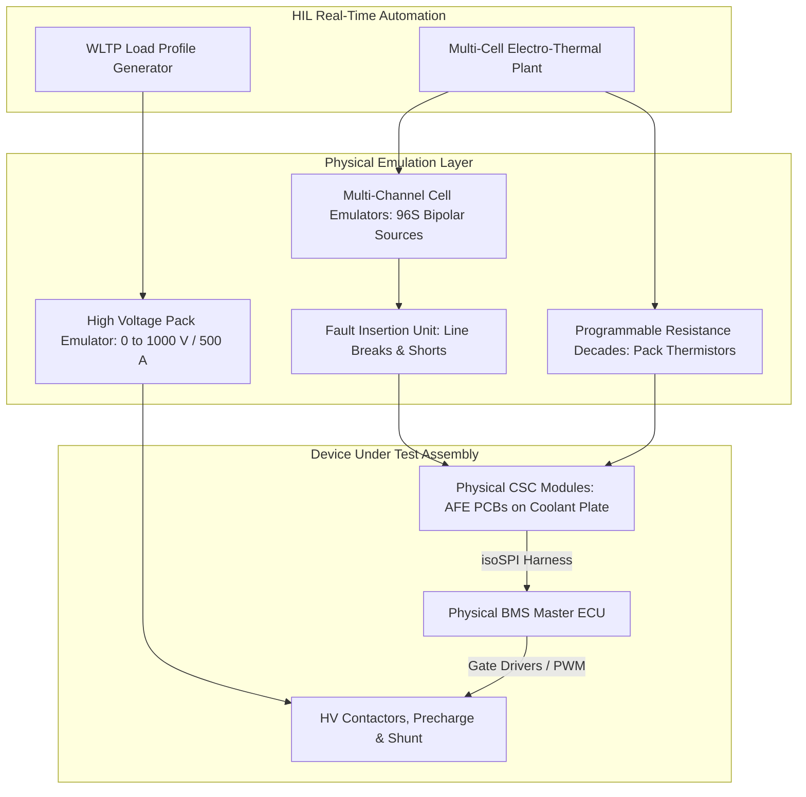
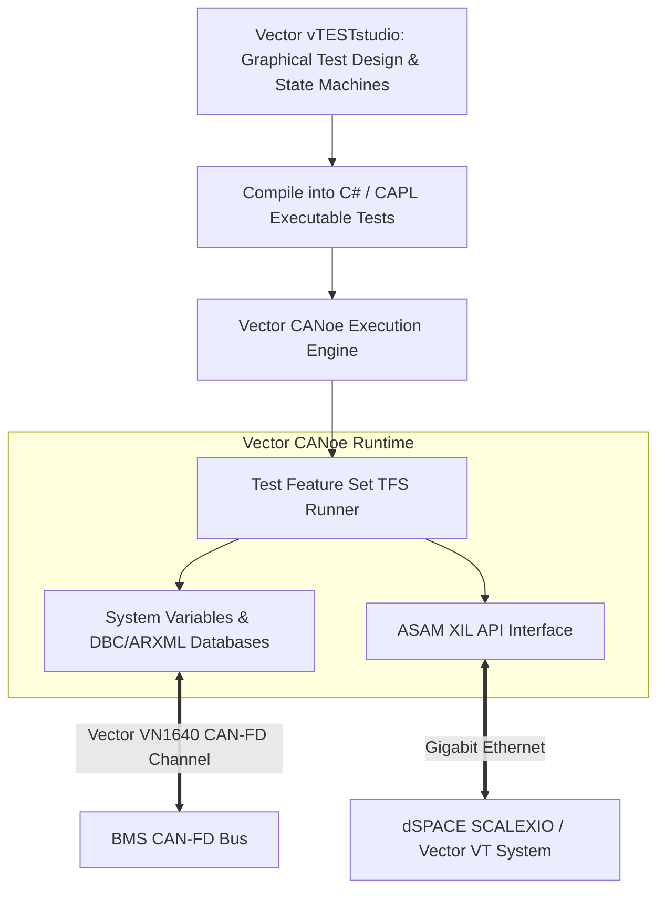

# Automotive BMS HIL Testing Frameworks

Comprehensive validation of a Battery Management System (BMS) requires testing both the master electronic control unit (BMS Master or Battery Management Controller, BMC) and the distributed slave cell monitoring modules (Cell Supervision Circuits, CSCs, or Cell Monitoring Controllers, CMCs)[^Ploeger2018]. In industrial verification pipelines, two fundamentally distinct HIL paradigms are utilized depending on development maturity, safety hazards, and hardware availability: **Signal-Level Testing (Virtual CSC)** and **High-Voltage Physical-Level Testing (Cell Emulation)**[^Kramer2019].

This chapter provides an exhaustive technical comparison of these testing paradigms, exploring Cell Controller Virtualization (CCV), proprietary isolated serial communication protocols (e.g., isoSPI), automated test frameworks (Vector CANoe / vTESTstudio), and functional safety verification under **ISO 26262** and **ASPICE SWE.5**[^ISO26262_4].

---

## 1. HIL Testing Paradigm Comparison

Selecting between signal-level and high-voltage testing dictates the complexity, cost, and physical safety footprint of the HIL facility.

```mermaid
flowchart TD
    subgraph Signal_Level["1. Signal-Level HIL (Cell Controller Virtualization)"]
        RT_SIM1[Real-Time Multiphysics Model: 96S Pack] --> FPGA_CCV[FPGA-Based Virtual CSC Emulation]
        FPGA_CCV --> PHY_TRANS[Proprietary Transceiver: isoSPI / UART Isolated]
        PHY_TRANS -->|Isolated Differential 2-Wire| BMC_ONLY[Device Under Test: BMS Master Controller Only]
    end

    subgraph High_Voltage["2. High-Voltage Physical HIL (Cell & Pack Emulation)"]
        RT_SIM2[Real-Time Multiphysics Model: 96S Pack] --> CELL_DAC[Precision 4-Quadrant Cell Emulators]
        CELL_DAC -->|96 Analog Voltage Taps + NTC Resistors| REAL_CSC[Physical Slave CSC Hardware]
        REAL_CSC -->|isoSPI Daisy-Chain| BMC_FULL[Device Under Test: BMS Master + Physical CSCs]
        HV_BUS[1500V DC Power Supply & Load Sink] -->|High Voltage Bus| HV_BOX[High Voltage Junction Box & Contactors]
    end
```



### 1.1 Technical Trade-Off Matrix

| Dimension | Signal-Level Testing (Virtual CSC) | High-Voltage Physical Testing (Full HIL) |
| :--- | :--- | :--- |
| **Device Under Test (DUT)** | BMS Master Controller (BMC) only | Full System: BMC + Physical CSCs + HVJB |
| **Cell Voltage Generation** | Simulated purely in software/FPGA registers | Physical 4-quadrant analog power stages ($\pm 1\,\text{mV}$) |
| **Communication Interface** | Isolated differential bus (isoSPI, TI UART) | Physical wire taps on sensing PCB terminals |
| **Physical Voltage Levels** | Low-voltage only ($< 60\,\text{V}$ SELV safe) | Full traction pack voltage ($400\,\text{V} - 1,000\,\text{V}$ hazardous) |
| **Active/Passive Balancing** | Emulated numerically in algorithm states | Physical balancing resistors sink real heat ($100\,\text{mA} - 2\,\text{A}$) |
| **Safety Cage & Interlocks** | Not required (Desktop / Rack mountable) | Mandatory (Category 4 / PLe safety cage & E-Stop) |
| **Development Phase** | Early architecture & functional verification | Late verification, production sign-off, homologation |
| **System Cost & Footprint** | Low cost, compact 19" 3U subrack | High investment, multi-cabinet 42U rack assembly |

---

## 2. Cell Controller Virtualization (CCV)

When physical CSC hardware is not yet manufactured or when scaling up to hundreds of cells (e.g., in stationary grid storage or 800V BEVs), **Cell Controller Virtualization (CCV)** replaces the physical Analog Front-End (AFE) silicon with deterministic FPGA logic[^dSPACE2023].



### 2.1 The FPGA Protocol Engine
Commercial AFE chips use proprietary, high-speed, isolated communication protocols rather than standard CAN. The CCV engine emulates these chip behaviors at the silicon register level:
- **Analog Devices / Linear Technology (isoSPI™)**: 2-wire pulse-transformer isolated SPI operating at $1\,\text{Mbps}$. Emulates chips such as the LTC6811, ADBMS1818, and ADBMS6830[^AnalogDevices2020].
- **Texas Instruments (iso-UART / BQ-series)**: Proprietary differential capacitive/transformer isolated UART operating at up to $2\,\text{Mbps}$ for the BQ79616-Q1 family.
- **NXP (iso-TPL)**: Isolated 2-wire differential communication for the MC33771 / MC33772 battery cell controller ICs.

### 2.2 CRC and Error Injection at Bit-Level
The CCV FPGA engine computes the Packet Error Code (PEC) or Cyclic Redundancy Check (CRC-15 / CRC-16) in real time:

$$
P(x) = x^{15} + x^{14} + x^{10} + x^8 + x^7 + x^4 + x^3 + 1
$$

To test the BMC's fault tolerance, the CCV engine can deliberately corrupt the CRC bitstream, inject single-bit bitflips, or withhold acknowledgment pulses to verify whether the BMC flags a communication timeout within the required Fault Tolerant Time Interval (FTTI $\le 100\,\text{ms}$)[^ISO26262_5].

---

## 3. High-Voltage Pack-Level HIL Architecture

In high-voltage physical HIL testbenches, the physical BMS Master and all physical CSC modules are wired directly to the test system.



### 3.1 Hardware Interfacing Challenges
1. **Galvanic Isolation**: The cell emulation channels must maintain strict dielectric isolation (minimum $1,500\,\text{V}$ DC) between each channel and against chassis ground. Any ground loop through the emulator will trigger spurious isolation alarms or destroy the AFE input stages.
2. **Dynamic Balancing Current Handling**: When the CSC initiates passive cell balancing by switching on its onboard discharge resistor ($R_{\text{bal}} \approx 33\,\Omega \implies I_{\text{bal}} \approx 100 - 150\,\text{mA}$), the emulator channel must act as a precise **current sink** without allowing the terminal voltage to collapse[^Baronti2014].
3. **Capacitive Common-Mode Noise**: In full powertrain HIL testing, rapid switching of the traction inverter ($dV/dt \ge 10\,\text{kV}/\mu\text{s}$) injects high-frequency common-mode currents across parasitic capacitances. The HIL simulator must replicate this electromagnetic noise environment to validate BMS EMC resilience.

---

## 4. Test Automation with Vector CANoe and vTESTstudio

In automotive OEM and Tier-1 environments, test automation is predominantly orchestrated via **Vector CANoe** coupled with **vTESTstudio** and the **ASAM XIL** interface[^Vector2022].



### 4.1 Production Automated Test Script (CAPL Example)
The following Vector CAPL (Communication Access Programming Language) script automates an ISO 26262 Over-Temperature Protection (OTP) test:

```c
/* Vector CAPL Script: Automated BMS Over-Temperature Safety Verification */
variables {
  msTimer otpTimer;
  const float T_CRITICAL_CELSIUS = 60.0;
  const long FTTI_LIMIT_MS = 200;
  long startTime = 0;
  long tripTime = 0;
}

testcase TC_BMS_OverTemperature_Trip()
{
  testCaseTitle("TC_BMS_OTP_001", "Verify Contactors Open within FTTI upon Cell Over-Temperature");
  
  // Step 1: Precondition - System in RUN State with closed contactors
  @sysvar::HIL::BatteryPack::Current = 50.0; // 50 A discharge
  testWaitForTimeout(1000);
  
  if (@sysvar::DUT::Contactor_Status != 1) { // 1 = CLOSED
    testStepFail("Precondition Failed: Contactors are not closed.");
    return;
  }
  testStepPass("Precondition Verified: BMS running with contactors closed.");

  // Step 2: Stimulate Over-Temperature Condition on NTC Channel 4
  testStep("Stimulate Fault", "Setting NTC_Cell_4 temperature to 62 degC");
  startTime = timeNow() / 100; // Time in milliseconds
  @sysvar::HIL::NTC_Sensors::Cell_4_Temp = 62.0;

  // Step 3: Await Contactor Disconnect
  if (testWaitForSysVar(@sysvar::DUT::Contactor_Status, 0, FTTI_LIMIT_MS) == 1) {
    tripTime = (timeNow() / 100) - startTime;
    testStepPass("Safety Interlock Tripped", "Contactors opened in %d ms (FTTI <= %d ms)", tripTime, FTTI_LIMIT_MS);
  } else {
    testStepFail("Safety Violation", "Contactors FAILED to open within FTTI limit of %d ms!", FTTI_LIMIT_MS);
  }

  // Step 4: Post-condition cleanup
  @sysvar::HIL::NTC_Sensors::Cell_4_Temp = 25.0;
  @sysvar::HIL::BatteryPack::Current = 0.0;
}
```

---

## 5. Industrial Safety Standards and Certification

HIL testing constitutes the primary empirical evidence presented in the **ISO 26262 Safety Case** for ASIL-C/D functional safety sign-off[^ISO26262_4].

### Safety Case Evidence Criteria
1. **Fault Coverage Evidence**: Demonstration that 100% of single-point hardware faults (open wires, short-to-ground, short-to-battery) mapped in the FMEDA are detected and transitioned to a safe state within the FTTI.
2. **Stress and Boundary Testing**: Verifying that algorithmic numerical overruns do not occur when signals saturate (e.g., cell voltages reaching $5.0\,\text{V}$ or dropping to $0.0\,\text{V}$).
3. **Traceability**: Direct linking between requirements (in Polarion / DOORS), test cases (in vTESTstudio), execution logs, and automated defect reports in Jira.

---

## 6. References

[^Ploeger2018]: M. Ploeger and H. V. Richter, "Hardware-in-the-Loop Simulation for Modern High-Voltage Automotive Systems," *ATZelektronik worldwide*, vol. 13, no. 4, pp. 38–43, 2018. [DOI: 10.1007/s38314-018-0036-7](https://doi.org/10.1007/s38314-018-0036-7)
[^Kramer2019]: B. Kramer, R. Simons, and S. Huh, "Model-Based Design of Battery Management Systems for Electric Vehicles," *SAE Technical Paper 2019-01-0872*, 2019. [DOI: 10.4271/2019-01-0872](https://doi.org/10.4271/2019-01-0872)
[^ISO26262_4]: International Organization for Standardization, "Road vehicles — Functional safety — Part 4: Product development at the system level," *ISO Standard 26262-4:2018*, Dec. 2018.
[^dSPACE2023]: dSPACE GmbH, "SCALEXIO® Hardware and Architecture Manual," *dSPACE Technical Documentation*, Paderborn, Germany, 2023.
[^AnalogDevices2020]: Analog Devices Inc., "ADBMS6830 16-Channel Multicell Battery Monitor Technical Datasheet," *Analog Devices Inc.*, Norwood, MA, 2020.
[^ISO26262_5]: International Organization for Standardization, "Road vehicles — Functional safety — Part 5: Product development at the hardware level," *ISO Standard 26262-5:2018*, Dec. 2018.
[^Baronti2014]: F. Baronti, R. Roncella, and R. Saletti, "Performance comparison of active balancing techniques for lithium-ion batteries," *Journal of Power Sources*, vol. 267, pp. 603–609, 2014.
[^Vector2022]: Vector Informatik GmbH, "CANoe & vTESTstudio User Manual (Version 16.0)," *Vector Informatik GmbH*, Stuttgart, Germany, 2022.
