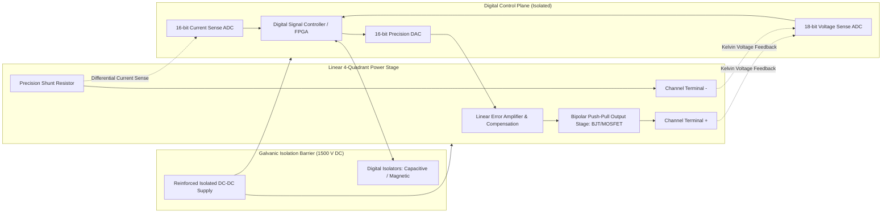
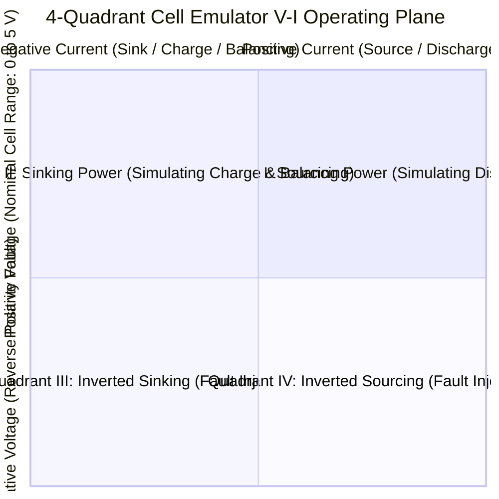
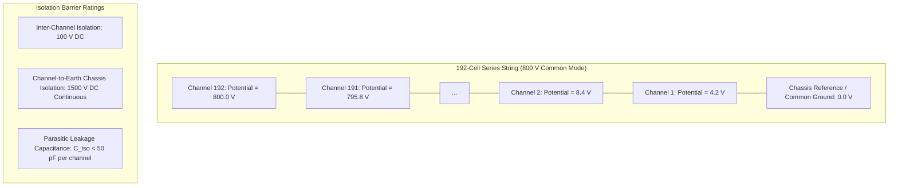

# Precision Battery Cell Emulation Hardware

Physical lithium-ion cells present severe safety, variability, and degradation challenges when utilized for software validation: testing edge-case failures—such as extreme overvoltage, deep thermal runaway, or internal dendrite micro-shorts—destroys physical cells and risks toxic gas venting or fires. Consequently, modern battery HIL test benches replace physical chemistry with **Precision Battery Cell Emulators**[^Ploeger2018].

A cell emulator is not a simple programmable DC power supply. It is a specialized, multi-channel, galvanically isolated, **4-quadrant bipolar power electronic instrument** engineered to reproduce electrochemical dynamic impedance, millivolt-level accuracy, and high sink/source currents at microsecond bandwidths[^Andrea2020].

This chapter provides an in-depth analysis of cell emulation hardware: 4-quadrant converter topologies, dynamic balancing sink mechanics, galvanic isolation architectures, and programmable temperature emulation.

---

## 1. Electrical Architecture of a Cell Emulation Channel

To accurately interface with an automotive Analog Front-End (AFE), each individual cell emulator channel must operate across both sourcing (discharging) and sinking (charging/balancing) modes.



### 1.1 Four-Quadrant Operational Envelope

A standard laboratory power supply operates exclusively in Quadrant I (positive voltage, positive sourcing current). A cell emulator channel must seamlessly traverse **Quadrant I and Quadrant II**:



- **Quadrant I ($V > 0, I > 0$)**: The emulator acts as a power source, simulating a discharging cell delivering load current to the vehicle powertrain.
- **Quadrant II ($V > 0, I < 0$)**: The emulator acts as an active electronic sink, absorbing regenerative braking currents or sinking passive cell balancing currents initiated by the BMS AFE.

---

## 2. Dynamic Performance and Metrological Requirements

BMS AFEs (such as the Analog Devices ADBMS6830 or Texas Instruments BQ79616) utilize high-resolution $\Delta\Sigma$ converters with measurement resolutions down to $100\,\mu\text{V}$ and accuracies within $\pm 1.5\,\text{mV}$[^AnalogDevices2020]. To prevent the test equipment from dominating the measurement uncertainty budget, the emulator must exceed the AFE's precision by at least a factor of three (Test Uncertainty Ratio $\text{TUR} \ge 3:1$)[^Taylor1997].

### 2.1 Critical Emulation Metrology Specifications

| Metrological Parameter | Target Specification | Physical Justification in BMS Testing |
| :--- | :--- | :--- |
| **Voltage Range** | $0.000\,\text{V}$ to $+5.500\,\text{V}$ (or $-2.0\,\text{V}$ fault) | Covers deep discharge (LFP cutoff $2.0\,\text{V}$) to extreme OVP ($4.5\,\text{V}$). |
| **Absolute Voltage Accuracy**| $\le \pm 1.0\,\text{mV}$ across full temperature range | Eliminates false-positive OVP/UVP diagnostics during calibration. |
| **Measurement Resolution** | 16-bit to 18-bit ($\le 100\,\mu\text{V}$) | Enables detection of minute balancing voltage shifts. |
| **Ripple and Noise** | $< 500\,\mu\text{V}_{\text{RMS}}$ ($10\,\text{Hz} - 100\,\text{kHz}$) | Prevents high-frequency switching noise from aliasing AFE ADC filters. |
| **Current Sink/Source** | $\pm 3.0\,\text{A}$ continuous ($\pm 5.0\,\text{A}$ peak) | Absorbs full passive balancing currents and module pulse loads. |
| **Current Measurement Accuracy**| $\pm 0.1\%$ Full Scale ($\pm 3\,\text{mA}$) | Verifies exact cell-by-cell balancing current consumption. |
| **Dynamic Response Time** | $\le 10\,\mu\text{s}$ for $10\% \to 90\%$ load step | Accurately reproduces fast inverter switching current pulses. |
| **Output Impedance ($Z_{\text{out}}$)**| Programmable: $0\,\text{m}\Omega$ to $100\,\text{m}\Omega$ | Hardware reproduction of high-frequency internal resistance $R_0$. |

---

## 3. Passive Balancing Load Sinking

Cell balancing verification is one of the most hardware-demanding tasks in BMS testing. When a cell reaches the balancing threshold, the AFE closes an internal or external MOSFET, discharging current through a bypass resistor $R_{\text{bal}}$[^Baronti2014].


### 3.1 Sinking Dynamics and Thermal Management
When the balancing switch closes:

$$
I_{\text{bal}} = \frac{V_{\text{cell}}}{R_{\text{bal}} + R_{\text{MOSFET}} + 2 R_{\text{trace}}} \approx \frac{4.20\,\text{V}}{33\,\Omega} \approx 127.3\,\text{mA}
$$

For an 8-channel board with all cells balancing concurrently:

$$
P_{\text{sink}} = 8 \times (4.20\,\text{V} \times 0.1273\,\text{A}) \approx 4.28\,\text{W}
$$

If testing high-current commercial vehicle active/passive balancing ($I_{\text{bal}} = 2.0\,\text{A}$ per cell), the board must dissipate or regenerate up to $67.2\,\text{W}$ continuously. Industrial emulator channels incorporate active forced-air cooling, copper vapor chambers, or backplane regenerative DC rails to dissipate this thermal energy without drifting calibration accuracy[^Andrea2020].

---

## 4. Galvanic Isolation and High-Voltage Stacking

In an 800V traction battery pack, up to 192 cells are connected in series. The emulator channels must be cascaded identically in series:



### 4.1 Dielectric Breakdown and Parasitic Capacitance Hazards
- **Common-Mode Voltage Stress**: Channel 192 operates at $+800\,\text{V}$ above earth ground. Its isolated DC-DC converter and digital isolation optocouplers/capacitive barriers must guarantee dielectric insulation conforming to **IEC 60664-1** and **UL 61010-1**[^IEC60664].
- **Capacitive Leakage Currents**: In fast transient environments ($dV/dt$), parasitic capacitance to the grounded enclosure introduces displacement currents:

$$
i_{\text{leak}} = C_{\text{parasitic}} \frac{dV_{\text{common}}}{dt}
$$

If $C_{\text{parasitic}} = 100\,\text{pF}$ and an inverter transient exhibits $\frac{dV}{dt} = 10\,\text{kV}/\mu\text{s}$, the leakage current pulse is $i_{\text{leak}} = 1.0\,\text{A}$. Without low-capacitance isolation barrier design ($C_{\text{iso}} \le 30\,\text{pF}$), this current flows into the AFE sensing traces, corrupting ADC readings or destroying input multiplexers.

---

## 5. Programmable Temperature Sensor Emulation

Battery packs deploy Negative Temperature Coefficient (NTC) or Positive Temperature Coefficient (PTC) thermistors embedded throughout the module busbars and cell casings to monitor thermal health.

```mermaid
flowchart LR
    subgraph Emulation_Engine["Digital Resistor Decade Channel"]
        DAC_CTRL[16-bit DAC / Relay Ladder]
        FET_R[Solid-State Variable Resistor / Precision FET Stage]
        CALIB_ROM[Steinhart-Hart Calibration LUT]
        
        CALIB_ROM --> DAC_CTRL
        DAC_CTRL --> FET_R
    end

    subgraph DUT_Interface["AFE Thermistor Sense Circuit"]
        V_REF[AFE Internal Reference Voltage: 3.300 V]
        R_PULLUP[Precision Pull-Up Resistor: 10.0 kOhm]
        AFE_ADC[AFE 16-bit GPIO ADC]
        
        V_REF --- R_PULLUP
        R_PULLUP --- AFE_ADC
    end

    FET_R <==>|Emulated Resistance: R_NTC(T)| AFE_ADC
```

### 5.1 The Steinhart-Hart Transformation

The real-time electro-thermal model calculates cell temperature $T$ in Kelvin. The programmable resistor module computes the corresponding target resistance $R_{\text{NTC}}$ via the inverted **Steinhart-Hart Equation**[^Steinhart1968]:

$$
\frac{1}{T} = A + B \ln(R) + C (\ln(R))^3
$$

or using the simplified exponential B-parameter formulation:

$$
R_{\text{NTC}}(T) = R_0 \exp\left( B \left( \frac{1}{T} - \frac{1}{T_0} \right) \right)
$$

For a standard $10\,\text{k}\Omega$ NTC ($R_0 = 10,000\,\Omega$ at $T_0 = 298.15\,\text{K}, B = 3435\,\text{K}$):
- At $T = -20^\circ\text{C}$ ($253.15\,\text{K}$): $R_{\text{NTC}} \approx 97,070\,\Omega$
- At $T = +25^\circ\text{C}$ ($298.15\,\text{K}$): $R_{\text{NTC}} = 10,000\,\Omega$
- At $T = +60^\circ\text{C}$ ($333.15\,\text{K}$): $R_{\text{NTC}} \approx 2,488\,\Omega$

The emulator channel updates its resistance output dynamically with sub-millisecond response times, allowing validation of sudden coolant loss or exothermic thermal runaway detection algorithms.

---

## 6. References

[^Ploeger2018]: M. Ploeger and H. V. Richter, "Hardware-in-the-Loop Simulation for Modern High-Voltage Automotive Systems," *ATZelektronik worldwide*, vol. 13, no. 4, pp. 38–43, 2018. [DOI: 10.1007/s38314-018-0036-7](https://doi.org/10.1007/s38314-018-0036-7)
[^Andrea2020]: D. Andrea, *Battery Management Systems for Large Lithium-Ion Battery Packs*, Artech House, 2020.
[^AnalogDevices2020]: Analog Devices Inc., "ADBMS6830 16-Channel Multicell Battery Monitor Technical Datasheet," *Analog Devices Inc.*, Norwood, MA, 2020.
[^Taylor1997]: J. R. Taylor, *An Introduction to Error Analysis: The Study of Uncertainties in Physical Measurements*, University Science Books, 1997.
[^Baronti2014]: F. Baronti, R. Roncella, and R. Saletti, "Performance comparison of active balancing techniques for lithium-ion batteries," *Journal of Power Sources*, vol. 267, pp. 603–609, 2014.
[^IEC60664]: International Electrotechnical Commission, "Insulation coordination for equipment within low-voltage systems," *IEC Standard 60664-1:2020*, 2020.
[^Steinhart1968]: J. S. Steinhart and S. R. Hart, "Calibration curves for thermistors," *Deep Sea Research and Oceanographic Abstracts*, vol. 15, no. 4, pp. 497–503, 1968.
