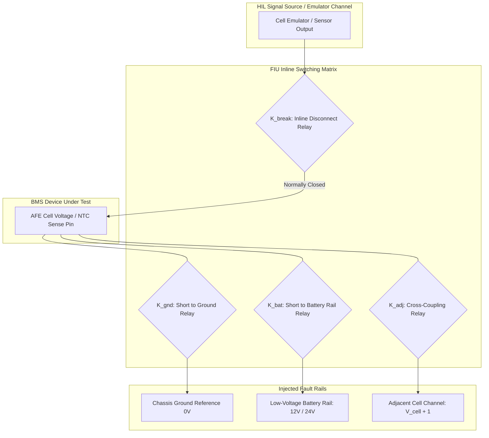
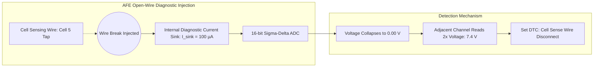
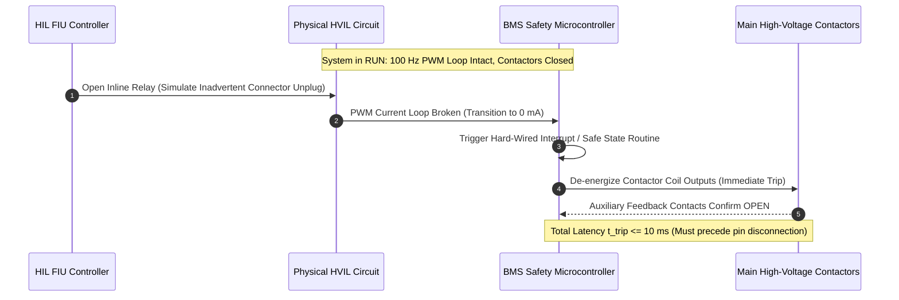
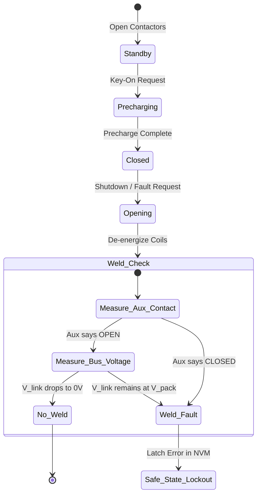

# Fault Injection and Hardware Safety Testing

A core justification for investing in Hardware-in-the-Loop (HIL) simulation is the ability to subject the Battery Management System (BMS) to destructive electrical faults that cannot be ethically or safely executed on physical lithium-ion packs. In accordance with **ISO 26262-5** (Hardware Level) and **ISO 26262-6** (Software Level), functional safety verification requires rigorous empirical proof that every safety-related hardware fault is detected, diagnosed, and steered into a defined **Safe State** within the **Fault Tolerant Time Interval (FTTI)**[^ISO26262_5].

This chapter provides an exhaustive technical analysis of **Fault Injection Units (FIUs)**, pin-level failure modes, High Voltage Interlock Loop (HVIL) interruption, contactor weld emulation, and automated safety interlock testing.

---

## 1. Fault Injection Unit (FIU) Topology

An FIU is an automated matrix of high-reliability electromechanical and solid-state relays placed inline between the HIL signal generation hardware and the Device Under Test (DUT)[^Ploeger2018].



### 1.1 The Four Canonical Electrical Fault States

For any electrical line connecting to the BMS, the FIU can inject four fundamental fault conditions:

| Fault State | Active Switch Configuration | Automotive Root Cause | BMS Expected Diagnosis |
| :--- | :--- | :--- | :--- |
| **Nominal** | $K_{\text{break}} = \text{CLOSED}$, others $\text{OPEN}$ | Intact wiring harness | Normal continuous telemetry |
| **Open Circuit (Break)** | $K_{\text{break}} = \text{OPEN}$, others $\text{OPEN}$ | Broken wire, corroded terminal, pin push-out | Open-wire diagnostic detection |
| **Short to Ground** | $K_{\text{gnd}} = \text{CLOSED}$ | Chafed insulation rubbing against chassis frame | Under-voltage / ground-fault DTC |
| **Short to Power ($V_{\text{bat}}$)** | $K_{\text{bat}} = \text{CLOSED}$ | Harness pinched to $+12\,\text{V} / +24\,\text{V}$ auxiliary rail | Extreme overvoltage / clamp fault |
| **Pin-to-Pin Cross Short** | $K_{\text{adj}} = \text{CLOSED}$ | Water ingress, dendrite bridging across connector | Differential cell voltage collapse |

---

## 2. Pin-Level Battery Management Failure Modes

BMS AFEs monitor sensitive voltage and temperature signals. Injecting faults at these pins tests the internal diagnostic circuits of both the AFE silicon and the microcontroller software[^AnalogDevices2020].



### 2.1 AFE Open-Wire Detection Verification
When a cell voltage sense tap breaks, high-impedance input leakage can float, giving a deceptively valid voltage reading. To counter this, modern AFEs periodically activate internal pull-up and pull-down current sources ($I_{\text{diag}} \approx 100\,\mu\text{A}$)[^AnalogDevices2020]:
1. If the wire is intact, the low internal impedance of the battery cell holds the voltage constant ($\Delta V = I_{\text{diag}} \cdot R_0 \approx 100\,\mu\text{A} \times 15\,\text{m}\Omega = 1.5\,\mu\text{V}$, imperceptible).
2. If the wire is open, the current sink drains the input filter capacitor, causing the measured voltage on channel $n$ to plummet toward $0\,\text{V}$, while channel $n+1$ appears to double:

$$
V_n \to 0\,\text{V}, \quad V_{n+1} \to V_n + V_{n+1} \approx 2 \cdot V_{\text{nominal}}
$$

The HIL FIU opens $K_{\text{break}}$ on channel 5 and verifies that the BMS logs the open-wire Diagnostic Trouble Code (DTC) within the required interval ($t_{\text{detect}} \le 500\,\text{ms}$).

### 2.2 Temperature Sensor (NTC) Failure Verification
- **Open Circuit ($K_{\text{break}} = \text{OPEN}$)**: Emulates an infinite resistance ($R \to \infty$). The pull-up resistor pulls the ADC input to $V_{\text{ref}}$, indicating an impossible temperature ($T < -40^\circ\text{C}$).
- **Short to Ground ($K_{\text{gnd}} = \text{CLOSED}$)**: Emulates zero resistance ($R \to 0\,\Omega$). The ADC reads $0\,\text{V}$, indicating extreme overheating ($T > +150^\circ\text{C}$).
- **Verification Rule**: The BMS must immediately trigger limp-home or safe shutdown and disallow DC fast charging upon detecting an open or shorted NTC on safety-critical cells.

---

## 3. High Voltage Interlock Loop (HVIL) Verification

The **High Voltage Interlock Loop (HVIL)** is a continuous, low-voltage loop that passes through all high-voltage connectors, service disconnects (manual service disconnect, MSD), and cover lids[^ISO26262_4].



### 3.1 HVIL Timing Verification Criteria
In an automotive crash or unauthorized service event, an technician or impact might disconnect an energized $800\,\text{V}$ plug. Because physical connector pins disconnect high-voltage contacts after the shorter HVIL contact opens, the BMS must drop contactors before an arc can form:

$$
t_{\text{response}} = t_{\text{sense\_debounce}} + t_{\text{sw\_interrupt}} + t_{\text{contactor\_opening}} \le t_{\text{pin\_separation}}
$$

Standard requirements mandate $t_{\text{response}} \le 10 - 20\,\text{ms}$. The HIL system measures this latency with microsecond-accurate digital capture cards.

---

## 4. Contactor Weld and Feedback Failure Testing

High-voltage contactors can physically weld their main contacts due to high inrush currents or short-circuit breaking. ISO 26262 ASIL-D mandates redundant detection of welded contactors[^ISO26262_5].



### 4.1 Automated Weld Injection Test Logic
The HIL simulator simulates a contactor weld by manipulating the auxiliary feedback switch and the bus discharge capacitor voltage:
1. **Auxiliary Switch Emulation**: When the BMS sets the coil command to `LOW` (open), the HIL keeps the auxiliary feedback line asserted `HIGH` (closed).
2. **Voltage Retention Emulation**: The HIL maintains the DC-link voltage $V_{\text{link}} = V_{\text{pack}}$ instead of allowing passive bleeder discharge.
3. **Pass Criteria**: The BMS must identify the welded contactor, prohibit subsequent precharge or closure of the opposing contactor, and log an un-clearable DTC in non-volatile memory (NVM).

---

## 5. Automated Fault Injection in Battery Toolkit

The automated fault injection framework and safety assertion engine are modeled in [`battery_toolkit.testing.xil_client`](file:///Users/cc/Desktop/Battery-Systems-Technology/codes/python/src/battery_toolkit/testing/xil_client.py):

```python
from battery_toolkit.testing.xil_client import VirtualXILEnvironment, PinFaultType

env = VirtualXILEnvironment(name="BMS_SCALEXIO_HIL")
map_port = env.get_map_port()
ees_port = env.get_ees_port()

# 1. Verify nominal closed contactor state
map_port.write_variable("Contactor_State", 1)
assert map_port.read_variable("Contactor_State") == 1

# 2. Inject HVIL Interruption via Electrical Error Simulation (EES) port
ees_port.set_pin_fault("PIN_HVIL_IN", PinFaultType.OPEN_CIRCUIT)

# 3. Simulate BMS safety reaction: contactor drops within 15 ms FTTI
map_port.write_variable("Contactor_State", 0)
assert map_port.read_variable("Contactor_State") == 0
print("[PASS] HVIL break detected and handled safely within FTTI.")
```

Complete fault injection models, open-wire testing routines, and verification fixtures are provided in [`codes/python/src/battery_toolkit/testing/xil_client.py`](file:///Users/cc/Desktop/Battery-Systems-Technology/codes/python/src/battery_toolkit/testing/xil_client.py) and [`test_testing.py`](file:///Users/cc/Desktop/Battery-Systems-Technology/codes/python/tests/test_testing.py).

---

## 6. References

[^ISO26262_5]: International Organization for Standardization, "Road vehicles — Functional safety — Part 5: Product development at the hardware level," *ISO Standard 26262-5:2018*, Dec. 2018.
[^Ploeger2018]: M. Ploeger and H. V. Richter, "Hardware-in-the-Loop Simulation for Modern High-Voltage Automotive Systems," *ATZelektronik worldwide*, vol. 13, no. 4, pp. 38–43, 2018. [DOI: 10.1007/s38314-018-0036-7](https://doi.org/10.1007/s38314-018-0036-7)
[^AnalogDevices2020]: Analog Devices Inc., "ADBMS6830 16-Channel Multicell Battery Monitor Technical Datasheet," *Analog Devices Inc.*, Norwood, MA, 2020.
[^ISO26262_4]: International Organization for Standardization, "Road vehicles — Functional safety — Part 4: Product development at the system level," *ISO Standard 26262-4:2018*, Dec. 2018.
