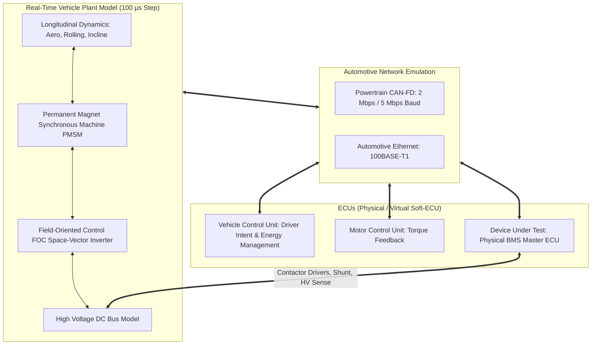
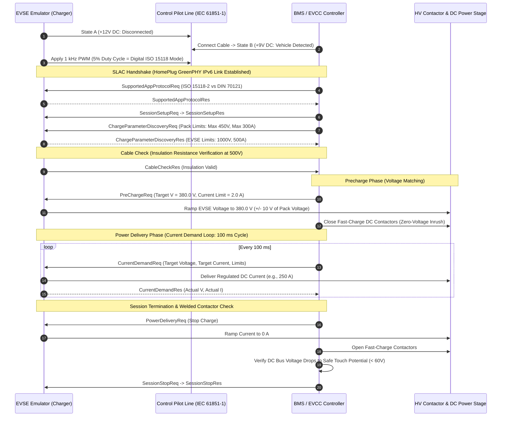
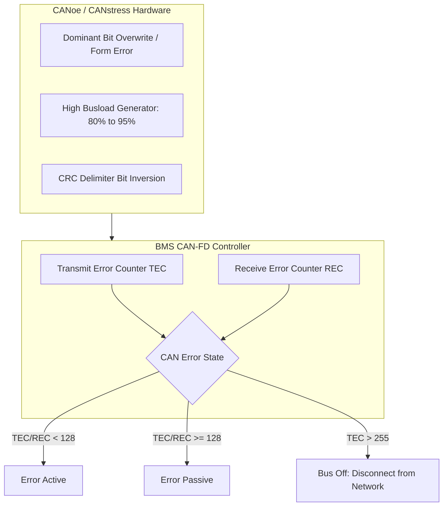

# EV Powertrain Integration and DC Fast Charging HIL

A Battery Management System does not operate in isolation; it functions as a central subsystem within an electrified vehicle network. Its performance and safety depend critically on real-time coordination with the **Vehicle Control Unit (VCU)**, **Traction Inverter (Motor Control Unit, MCU)**, and external **Electric Vehicle Supply Equipment (EVSE)**[^Ehsani2018]. Validating these multi-ECU interactions requires a **System-of-Systems HIL Testbench** that emulates full-vehicle longitudinal dynamics, high-voltage bus interaction, and international digital charging communication standards[^Schumacher2021].

This chapter details EV powertrain integration testing: multi-ECU CAN-FD networking, dynamic torque and regeneration derating, and Combined Charging System (CCS) DC fast-charging emulation conforming to **ISO 15118-2/20** and **DIN 70121**[^ISO15118].

---

## 1. Multi-ECU Powertrain Integration HIL Architecture

In a powertrain HIL test bench, the physical BMS is integrated into a network of simulated and physical vehicle control units communicating over CAN-FD and Automotive Ethernet.



### 1.1 Dynamic Energy Management and Derating Loops
To prevent cell degradation and thermal runaway, the BMS continuously calculates dynamic power limits and broadcasts them over CAN-FD to the VCU and MCU at $10\,\text{ms}$ intervals:
- **Maximum Permissible Discharge Power ($P_{\text{dis\_max}}$)**: Throttles traction motor acceleration torque during low SOC ($< 10\%$) or low cell temperatures ($T < 0^\circ\text{C}$).
- **Maximum Permissible Charge Power ($P_{\text{chg\_max}}$)**: Governs regenerative braking torque absorption. If the battery is at $95\%$ SOC or cell voltages exceed $4.15\,\text{V}$, regenerative torque is clamped to zero, requiring the mechanical friction brakes to compensate[^Ehsani2018].

The HIL simulator verifies that under aggressive step accelerations and emergency regenerative braking, the BMS dynamic limits are respected by the MCU without triggering false-positive overcurrent or overvoltage trips.

---

## 2. DC Fast Charging (CCS) HIL Emulation

High-voltage DC fast charging introduces extreme electrical power (up to $350\,\text{kW}$ at $800\,\text{V} / 500\,\text{A}$) and complex digital communication protocols. Emulating the EVSE enables exhaustive testing of the charging handshake without hazardous field equipment[^Schumacher2021].

```mermaid
flowchart LR
    subgraph EVSE_Emulator["dSPACE / Vector CCS EVSE Emulator"]
        PLC_MODEM[HomePlug GreenPHY QCA7000 Modem]
        PWM_PILOT[Control Pilot PWM Generator (+12V to -12V)]
        PROX_GEN[Proximity Pilot Resistor Matrix]
        DC_SIM[Programmable 1000V / 500A Bidirectional Source]
    end

    subgraph EV_Interface["Charging Inlet & On-Board Architecture"]
        CP_LINE[Control Pilot (CP) Line]
        PP_LINE[Proximity Pilot (PP) Line]
        PLC_EV[Vehicle GreenPHY Modem / EVCC]
        BMS_EV[BMS Master ECU]
        DC_PINS[DC+ and DC- High-Voltage Contactors]
    end

    PWM_PILOT <==>|1 kHz Duty Cycle| CP_LINE
    PROX_GEN <==>|Resistor Code| PP_LINE
    PLC_MODEM <==>|HomePlug GreenPHY OFDM| PLC_EV
    DC_SIM <==>|Controlled DC Fast Charge Power| DC_PINS
    PLC_EV <-->|CAN-FD / Ethernet| BMS_EV
```

### 2.1 The ISO 15118 / DIN 70121 Protocol Sequence

DC fast charging is structured as a deterministic finite-state sequence:



---

## 3. High-Voltage Precharge and Contact Welding Verification

A critical safety hazard during DC fast charging is contactor inrush erosion and welding.

### 3.1 Precharge Voltage Matching Equation
If the fast-charge contactors close while a significant voltage differential exists between the EVSE output capacitor and the battery pack, an uncontrolled inrush current will occur:

$$
I_{\text{inrush}} = \frac{\left| V_{\text{EVSE}} - V_{\text{pack}} \right|}{R_{\text{loop}}}
$$

With loop resistance $R_{\text{loop}} \approx 20\,\text{m}\Omega$, a $50\,\text{V}$ mismatch causes an instantaneous surge of:

$$
I_{\text{inrush}} = \frac{50\,\text{V}}{0.02\,\Omega} = 2,500\,\text{A}
$$

Such extreme current immediately welds contactor contacts or trips pyrofuses.

During HIL testing:
- **Test Case 1**: The EVSE emulator successfully matches voltage within $\pm 5\,\text{V}$. The BMS verifies voltage alignment and closes contactors with zero inrush.
- **Test Case 2 (Fault Injection)**: The EVSE emulator stops ramping at a $40\,\text{V}$ deficit. The HIL verifies that the BMS times out ($t_{\text{timeout}} \le 2.0\,\text{s}$), refuses to close contactors, issues an emergency stop over PLC, and logs an EVSE Precharge Failure DTC[^Schumacher2021].

---

## 4. Network Stress and Error Recovery Testing

Under real vehicle operating conditions, electromagnetic interference (EMI) from the inverter and high-voltage cabling can induce bit errors on the CAN-FD bus.



### 4.1 Bus-Off Recovery Protocol (AUTOSAR CanSM)
The HIL simulator verifies the **AUTOSAR CAN State Manager (CanSM)** recovery strategy:
1. Injected bit corruption forces the BMS into `BUS_OFF` ($TEC > 255$).
2. The BMS must immediately safe-state its torque and charging limits.
3. The CAN controller executes the standardized recovery sequence: monitoring 128 occurrences of 11 consecutive recessive bits before re-entering `ERROR_ACTIVE` mode[^AUTOSAR2020].

---

## 5. References

[^Ehsani2018]: M. Ehsani, Y. Gao, S. Longo, and K. M. Ebrahimi, *Modern Electric, Hybrid Electric, and Fuel Cell Vehicles*, 3rd ed., CRC Press, 2018.
[^Schumacher2021]: M. Schumacher, T. Minav, and P. Pietola, "Hardware-in-the-Loop Simulation for Electric Vehicle DC Fast Charging Infrastructure," *IEEE Transactions on Transportation Electrification*, vol. 7, no. 3, pp. 1120–1132, 2021. [DOI: 10.1109/TTE.2021.3051423](https://doi.org/10.1109/TTE.2021.3051423)
[^ISO15118]: International Organization for Standardization, "Road vehicles — Vehicle to grid communication interface — Part 2: Network and application protocol requirements," *ISO Standard 15118-2:2014*, 2014.
[^AUTOSAR2020]: AUTOSAR Consortium, "Specification of CAN State Manager (Release 4.4.0)," *AUTOSAR Standard Documents*, Nov. 2020.
