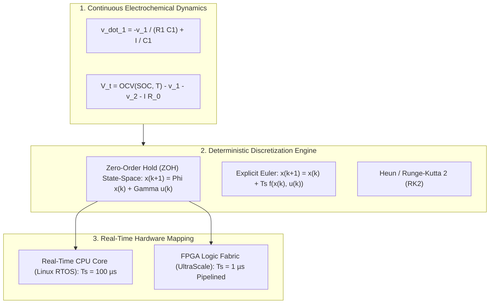
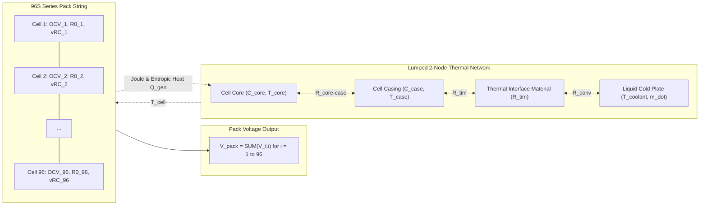
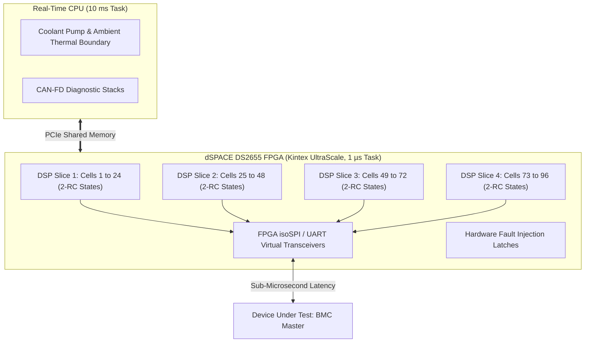
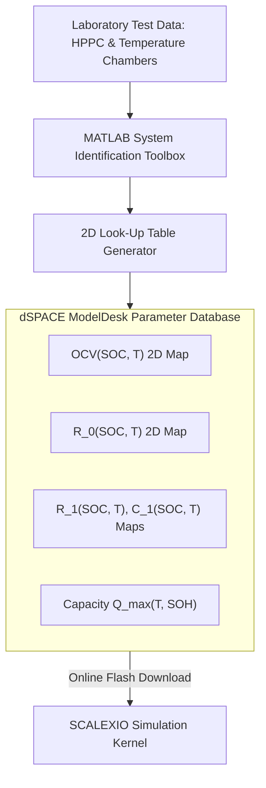

# Real-Time Electro-Thermal Battery Plant Simulation

Hardware-in-the-Loop (HIL) testing requires that the simulated battery pack behaves with absolute physical fidelity in real time. If the simulation model lags behind real-world clock time, or if numerical discretization introduces artificial oscillations, the Device Under Test (DUT) will record corrupted state estimates or fail timing deadlines[^Ploeger2018]. To achieve sub-millivolt accuracy and microsecond responsiveness across large packs (e.g., $96\text{S}2\text{P}$ to $192\text{S}1\text{P}$), simulation platforms employ specialized real-time model packages, such as the **dSPACE Automotive Simulation Models (ASM) Battery** or **MathWorks Simscape™ Battery**, executing across multi-core CPUs and dedicated FPGAs[^dSPACE2023].

This chapter explores the mathematical discretization, state-space formulations, lumped-parameter multi-node thermal networks, and FPGA deployment strategies necessary for deterministic real-time execution.

---

## 1. Mathematical Discretization for Real-Time Execution

In desktop simulation, variable-step solvers (e.g., `ode23t`, `ode15s`) adjust the time step dynamically to manage stiff differential equations. In a real-time HIL environment, variable-step solvers are prohibited: the computational execution time must strictly satisfy a **fixed-step sample time** ($T_s \le 100\,\mu\text{s}$ on CPU, or $T_s \le 1\,\mu\text{s}$ on FPGA)[^Plett2015].

### 1.1 Zero-Order Hold (ZOH) State-Space Exact Discretization
For an individual RC overpotential branch:

$$
\frac{d v_{\text{rc}}(t)}{dt} = -\frac{1}{\tau} v_{\text{rc}}(t) + \frac{1}{C} I(t)
$$

where $\tau = R \cdot C$. Assuming the current $I(t)$ is constant over the sample period $[k T_s, (k+1) T_s)$ (Zero-Order Hold assumption), the exact analytical discrete solution is:

$$
v_{\text{rc}}[k+1] = e^{-\frac{T_s}{\tau}} v_{\text{rc}}[k] + R \left( 1 - e^{-\frac{T_s}{\tau}} \right) I[k]
$$

Letting $\alpha = e^{-\frac{T_s}{\tau}}$ and $\beta = R (1 - \alpha)$, the state update reduces to two multiplications and one addition:

$$
v_{\text{rc}}[k+1] = \alpha \cdot v_{\text{rc}}[k] + \beta \cdot I[k]
$$

This exact formulation eliminates numerical damping and artificial drift, maintaining unconditional numerical stability regardless of the ratio $\frac{T_s}{\tau}$[^Plett2015].

---

## 2. Multi-Cell Pack Electro-Thermal Topology

Modern electric vehicle packs contain hundreds of cells grouped into series modules. The real-time model must calculate individual cell terminal voltages concurrently to feed the multi-channel cell emulators.

### 2.1 Lumped-Parameter Thermal State Equations
To accurately simulate thermal gradients during extreme fast charging, a 2-node thermal model is solved for every cell:
1. **Core Node ($T_{\text{core}}$)**: Generates heat via internal resistance and entropic changes:

$$
C_{\text{core}} \frac{d T_{\text{core}, i}}{dt} = \dot{Q}_{\text{gen}, i} - \frac{T_{\text{core}, i} - T_{\text{case}, i}}{R_{\text{cc}}}
$$

where $\dot{Q}_{\text{gen}, i} = I^2 R_{0, i} + \sum_j \frac{v_{\text{rc}, j, i}^2}{R_{j, i}} + I T_{\text{core}, i} \frac{\partial \text{OCV}_i}{\partial T}$.

2. **Casing Node ($T_{\text{case}}$)**: Conducts heat through the thermal interface material (TIM) to the liquid cold plate:

$$
C_{\text{case}} \frac{d T_{\text{case}, i}}{dt} = \frac{T_{\text{core}, i} - T_{\text{case}, i}}{R_{\text{cc}}} - \frac{T_{\text{case}, i} - T_{\text{coolant}}}{R_{\text{tim}} + R_{\text{plate}}}
$$

Because thermal time constants ($\tau_{\text{thermal}} \sim 10 - 100\,\text{s}$) are orders of magnitude slower than electrical time constants ($\tau_{\text{electrical}} \sim 0.1 - 10\,\text{s}$), the thermal equations can be executed at a sub-rate (e.g., $10\,\text{ms}$) to preserve CPU execution budget[^Kramer2019].

---

## 3. FPGA-Based Simulation for Large Cell Counts

When battery pack architectures scale to high cell counts (e.g., $192\text{S}$ to $400\text{S}$ in heavy commercial vehicles or eVTOL aircraft), solving hundreds of stiff differential equations on standard x86 CPU cores within a $100\,\mu\text{s}$ budget causes CPU task overruns.

### 3.1 FPGA Execution Characteristics
- **Parallel Pipeline Execution**: FPGAs feature thousands of dedicated DSP slices capable of executing floating-point or 32-bit fixed-point multiplications concurrently. All 96 or 192 cells are computed in parallel within clock cycles rather than sequentially.
- **Ultra-Low Latency ($< 1\,\mu\text{s}$)**: Real-time update rates under $1\,\mu\text{s}$ eliminate phase lag, allowing high-fidelity simulation of inverter switching harmonics ($10\,\text{kHz} - 20\,\text{kHz}$) on cell terminal voltages.

---

## 4. Parameterization and Model Desk Calibration

To ensure the simulation reflects actual physical cells, the ASM Battery models are parameterized using experimental test data (HPPC, GITT, and EIS)[^Ploeger2018].

### 4.1 Online Parameter Tuning
Through tools such as **dSPACE ModelDesk** or **ControlDesk**, test engineers can dynamically modify cell parameters during an active simulation run without recompiling the model:
- Injecting cell imbalance by shifting initial SOC on Cell #14 ($\text{SOC}_{14} = 65\%$ while others are at $80\%$).
- Simulating accelerated degradation by doubling $R_{0}$ on select cells to test end-of-life (EOL) thermal derating.
- Triggering micro-short circuits by applying a parallel leakage resistance ($R_{\text{leak}} = 5\,\Omega$).

---

## 5. References

[^Ploeger2018]: M. Ploeger and H. V. Richter, "Hardware-in-the-Loop Simulation for Modern High-Voltage Automotive Systems," *ATZelektronik worldwide*, vol. 13, no. 4, pp. 38–43, 2018. [DOI: 10.1007/s38314-018-0036-7](https://doi.org/10.1007/s38314-018-0036-7)
[^dSPACE2023]: dSPACE GmbH, "Automotive Simulation Models (ASM) - Battery Model User Guide," *dSPACE Technical Documentation*, Paderborn, Germany, 2023.
[^Plett2015]: G. L. Plett, *Battery Management Systems, Volume I: Battery Modeling*, Artech House, 2015.
[^Kramer2019]: B. Kramer, R. Simons, and S. Huh, "Model-Based Design of Battery Management Systems for Electric Vehicles," *SAE Technical Paper 2019-01-0872*, 2019. [DOI: 10.4271/2019-01-0872](https://doi.org/10.4271/2019-01-0872)
