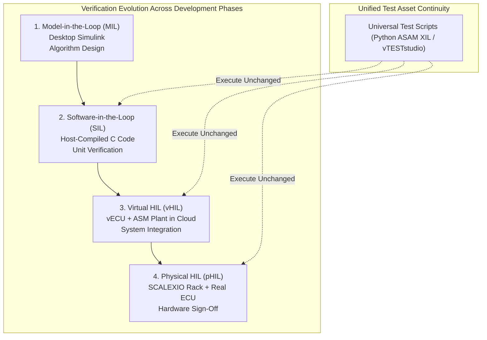
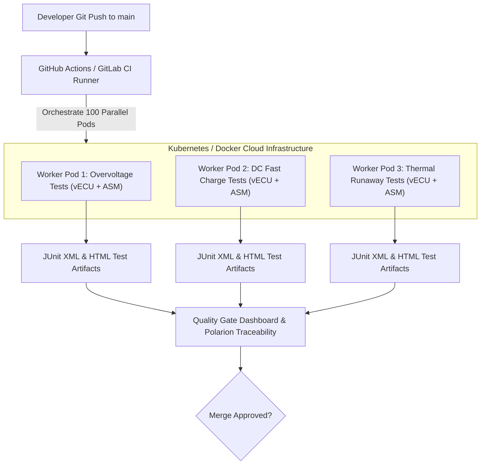
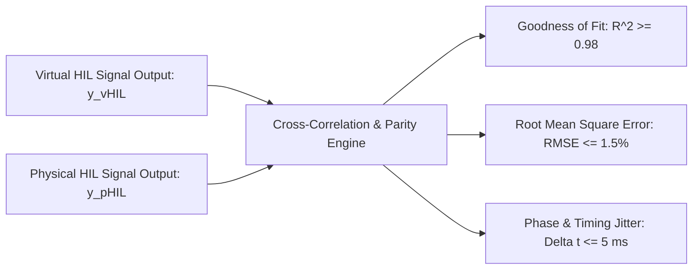

# SIL-to-HIL Continuity and Virtual HIL Architectures

In modern automotive software engineering, testing cannot wait for physical hardware availability. With tight vehicle development timelines, waiting for production microcontrollers, custom printed circuit boards (PCBs), and multi-rack Hardware-in-the-Loop (HIL) simulators introduces unacceptable bottlenecks. To overcome this, the industry employs a **Shift-Left Verification Strategy**, transitioning testing from physical testbenches into **Virtual HIL (vHIL)** and **Software-in-the-Loop (SIL)** environments running in automated cloud pipelines[^Broy2012].

This chapter explores SIL-to-HIL continuity: Virtual ECU (vECU) classification levels, AUTOSAR Basic Software (BSW) emulation, containerized cloud execution (Docker/Kubernetes), and cross-environment test reuse via the **ASAM XIL** API[^Kramer2019].

---

## 1. The Shift-Left Verification Paradigm

The shift-left approach moves verification from right to left along the automotive V-Model, enabling test cases designed for physical HIL racks to execute weeks or months earlier in virtual environments.



### 1.1 Comparative Matrix: SIL vs. Virtual HIL vs. Physical HIL

| Characteristic | Software-in-the-Loop (SIL) | Virtual HIL (vHIL) | Physical HIL (pHIL) |
| :--- | :--- | :--- | :--- |
| **Execution Environment** | Developer PC / Local OS | Cloud / Container (Docker / Linux) | Dedicated Real-Time Rack (SCALEXIO) |
| **Target Code** | Algorithmic C Code (No OS/BSW) | Full ECU Binary / vECU with BSW | Cross-Compiled Production Binary |
| **Hardware Emulation** | None (Direct function calls) | Virtual Processing Unit (QEMU / Synopsys) | Physical AURIX / ARM Microcontroller |
| **I/O & Peripherals** | Virtual memory pointers | Simulated CAN-FD, SPI, AFE drivers | Physical DACs, FIUs, and Relays |
| **Plant Model** | Simplified 1-RC / Ideal Pack | Real-Time Multiphysics ASM Battery | Real-Time ASM Battery on Multicore/FPGA |
| **Execution Speed** | Faster than Real-Time ($10\times$) | Variable (Real-Time to $2\times$ slower) | Strictly Real-Time ($1.0\times$, deterministic) |
| **Scalability** | Massive (Thousands of instances in parallel) | High (Cloud-based container orchestration) | Bounded (Limited by physical rack count) |
| **Unit Cost** | Near Zero | Low (Cloud compute instances) | High (\$100k - \$1M per testbench) |

---

## 2. Virtual ECU (vECU) Classification Levels

The automotive industry, spearheaded by the **AUTOSAR Development Partnership**, categorizes Virtual ECUs into distinct levels depending on the depth of Basic Software (BSW) and hardware virtualization[^AUTOSAR2020].

```mermaid
graph TD
    subgraph Level_1["Level 1: Functional vECU (Controller Algorithms Only)"]
        SWC1[Application SWCs: SOC, SOH, Balancing]
        V_RTE1[Virtual RTE: Direct Memory Exchange]
        SWC1 <--> V_RTE1
    end

    subgraph Level_2["Level 2: Behavioral vECU (Production RTE + BSW)"]
        SWC2[Application SWCs]
        PROD_RTE[Production AUTOSAR RTE]
        BSW_SIM[Simulated BSW: Com, CanIf, Dem, NvM]
        SWC2 <--> PROD_RTE
        PROD_RTE <--> BSW_SIM
    end

    subgraph Level_3["Level 3: Detailed Target vECU (Instruction-Set Simulator)"]
        BIN[Complete Target Binary: .ELF / .HEX]
        ISS[Instruction Set Simulator: QEMU / Virtualizer]
        HW_PERIPH[Emulated Hardware Peripherals: MCAL, DMA, Timers]
        BIN --> ISS
        ISS <--> HW_PERIPH
    end
```



### 2.1 Technical Details of vECU Levels
1. **Level 1 (Functional vECU)**:
   - Contains only application software components (SWCs).
   - Basic Software (BSW) and Microcontroller Abstraction Layer (MCAL) are stripped.
   - Ideal for quick regression testing of control state machines and SOC estimators.
2. **Level 2 (Behavioral vECU)**:
   - Compiles the application SWCs alongside production AUTOSAR RTE and major BSW stacks (Diagnostic Event Manager `Dem`, Non-Volatile Memory `NvM`, Communication `Com`).
   - MCAL is replaced by virtual transport layers (e.g., Virtual CAN sockets in Linux).
   - Enables full validation of diagnostic trouble codes (UDS ISO 14229) and network management without hardware.
3. **Level 3 (Target Instruction-Set vECU)**:
   - Emulates the actual microcontroller architecture (e.g., Infineon TriCore TC397 or ARM Cortex-R5F) via cycle-approximate simulators (Synopsys Virtualizer or QEMU).
   - Executes the exact compiled target `.elf` binary without source code modification[^Broy2012].

---

## 3. Containerized Cloud Execution in CI/CD Pipelines

Virtual HIL allows automotive software teams to execute hundreds of nightly integration tests in automated cloud pipelines (GitHub Actions, GitLab CI, Jenkins) using Docker containers[^Kramer2019].



### 3.1 Docker Compose Configuration for Virtual BMS HIL
The following configuration instantiates a complete virtual HIL environment, combining a Level 2 vECU with an ASM Battery plant simulation and a virtual CAN network.

```yaml
version: '3.8'

services:
  virtual_can_bus:
    image: automotive/vcan-router:latest
    container_name: vcan_network
    networks:
      bms_net:
        ipv4_address: 172.28.1.2

  asm_battery_plant:
    image: dspace/asm-battery-simulation:latest
    container_name: asm_plant
    environment:
      - PACK_CONFIG=96S2P_NMC
      - SOLVER_STEP=0.0001
      - VCAN_INTERFACE=vcan0
    depends_on:
      - virtual_can_bus
    networks:
      bms_net:
        ipv4_address: 172.28.1.3

  bms_vecu_controller:
    image: tier1/bms-vecu-asil-d:v2.4
    container_name: bms_vecu
    environment:
      - RTE_MODE=LEVEL_2_BEHAVIORAL
      - VCAN_INTERFACE=vcan0
    depends_on:
      - asm_battery_plant
    networks:
      bms_net:
        ipv4_address: 172.28.1.4

  test_runner:
    image: asam/xil-test-runner:python3.11
    container_name: asam_runner
    command: ["pytest", "--asam-xil-env=vHIL_Cloud", "/tests/bms_regression_suite.py"]
    depends_on:
      - bms_vecu_controller
    networks:
      bms_net:
        ipv4_address: 172.28.1.5

networks:
  bms_net:
    driver: bridge
    ipam:
      config:
        - subnet: 172.28.1.0/24
```

---

## 4. Test Parity and Model Continuity Metrics

A fundamental risk in virtual HIL is **Parity Divergence**: a test passing in vHIL might fail on physical HIL due to unmodeled real-time latency, bus jitter, or electrical transients.

### 4.1 Parity Metrics Formulation
To mathematically certify that a vHIL test run is valid evidence for ISO 26262 sign-off, signal correlation between vHIL and physical HIL must satisfy strict thresholds[^Taylor1997]:



The Normalized Cross-Correlation Coefficient $\rho_{xy}$ is calculated across time-series signals:

$$
\rho_{xy} = \frac{\sum_{k=1}^N \left( y_{\text{vHIL}}[k] - \bar{y}_{\text{vHIL}} \right) \left( y_{\text{pHIL}}[k] - \bar{y}_{\text{pHIL}} \right)}{\sqrt{\sum_{k=1}^N \left( y_{\text{vHIL}}[k] - \bar{y}_{\text{vHIL}} \right)^2 \sum_{k=1}^N \left( y_{\text{pHIL}}[k] - \bar{y}_{\text{pHIL}} \right)^2}}
$$

**Certification Criteria**:
- $\rho_{xy} \ge 0.98$ (98% profile correlation),
- Root-Mean-Square Error: $\text{RMSE} = \sqrt{\frac{1}{N} \sum_{k=1}^N (y_{\text{vHIL}}[k] - y_{\text{pHIL}}[k])^2} \le 1.5\%$,
- State machine transition sequence must match with $0$ permutation errors.

When these parity criteria are met, physical HIL testing is reserved strictly for final hardware homologation and electrical destructive fault tests, while 90% of all software regressions run autonomously in the virtual cloud.

---

## 5. References

[^Broy2012]: M. Broy, M. Feilkas, M. Herrmannsdoerfer, S. Merenda, and D. Ratiu, "Seamless model-based software engineering: Systems engineering meets software engineering," *IEEE Transactions on Software Engineering*, vol. 38, no. 5, pp. 1113–1129, 2012.
[^Kramer2019]: B. Kramer, R. Simons, and S. Huh, "Model-Based Design of Battery Management Systems for Electric Vehicles," *SAE Technical Paper 2019-01-0872*, 2019. [DOI: 10.4271/2019-01-0872](https://doi.org/10.4271/2019-01-0872)
[^AUTOSAR2020]: AUTOSAR Consortium, "Specification of Software Component Template (Release 4.4.0)," *AUTOSAR Standard Documents*, Nov. 2020.
[^Taylor1997]: J. R. Taylor, *An Introduction to Error Analysis: The Study of Uncertainties in Physical Measurements*, University Science Books, 1997.
